# DOK1 — Hedef ve Gereksinim Dokümanı (Biz Ne Yapmak İstiyoruz?)

> **4'lü Dokümantasyon Navigasyonu:**
> - **[DOK1 — Hedef ve Gereksinimler (Aktif)](file:///d:/Hoca/VideoOzet/docs/DOK1_HEDEF_VE_GEREKSINIMLER.md)**
> - [DOK2 — Mevcut Kod Debug ve Akış Raporu](file:///d:/Hoca/VideoOzet/docs/DOK2_MEVCUT_KOD_DEBUG_VE_AKIS_RAPORU.md)
> - [DOK3 — Endüstri, Benzer Projeler ve Literatür Araştırması](file:///d:/Hoca/VideoOzet/docs/DOK3_ENDUSTRI_VE_BENZER_PROJELER_ARASTIRMASI.md)
> - [DOK4 — Adım Adım Geliştirme Planı](file:///d:/Hoca/VideoOzet/docs/DOK4_ADIM_ADIM_GELISTIRME_PLANI.md)

---

## 1. Vizyon ve Temel Amaç

**VideoÖzet AI** projesinin asıl amacı; bir eğitime yüklenen **onlarca video ve PDF/Word/PPTX doküman kaynağını** (ör. 30–50+ kaynak, 1.5+ milyon karakter) hiçbir kaynağı gözden kaçırmadan analiz eden, telifli dış kaynakların cümlelerini kopyalamadan argüman ve kanıtlarını sentezleyen ve **en önemlisi kullanıcının kendi özgün tezini, felsefi/kavramsal çerçevesini ve anlatım kurgusunu merkeze koyarak** stüdyoda doğrudan okunabilecek derinlikte **Video Serisi Planı + Sahne Bazlı Çekim/Kurgu Planı + Tam Uzunlukta Prompter Konuşma Metni** üreten uçtan uca bir yapay zeka içerik stüdyosu olmaktır.

Mevcut sistemde yaşanan:
1. Seçilen modelin kaydedilmeyip sürekli Flash modeline dönmesi ve hata anında sessizce 5.800 karakterlik küçük Groq modeline düşerek kaynakları budaması,
2. Akıllı Seri Planlayıcının revizyon talimatlarını, istenen video sayısını ve süreyi yok sayması; `"Bölüm 1 (~5 dk)"` gibi sığ, jenerik kartlar üretmesi ve onay öncesi harita üzerinde düzenlemeye izin vermemesi,
3. 40+ kaynağın olduğu eğitimlerde sabit 24 parça sınırı ve 22.000 karakterlik kesik PDF özeti yüzünden kaynakların büyük çoğunluğuna hiç değinilmemesi,
4. Kullanıcının *"şunları da anlat, şu yaklaşımı öne çıkar"* dediği ama kaynaklarda doğrudan geçmeyen özgün yorumlarının ya hiç yazılmaması ya da Kalite Kontrol (QC) Auto-Refine aşamasında *"kaynakta desteklenmedi"* denilerek silinmesi,
5. 20–30 dakikalık video senaryolarının tek bir LLM çağrısında üretilmeye çalışılması sebebiyle düşünürlerin ve kavramların 2–3 cümleyle yüzeysel geçiştirilmesi,
6. Projede "varmış gibi" tanımlanmış ama gerçekte çalışmayan 12 yarım/sahte özelliğin (`UpdatePlanTexts`, `DevirNotuJson`, `BaglamEskidi`, `EkTonTalimati`, `HaricKonular/ZorunluKonular`, `KaynaktaOlmayanlar`, seri `Kanıtlar` sekmesi, canlı `KullanimTuru` senkronizasyonu vb.) tamamlanması

bu dönüşümün ana hedefidir.

---

## 2. İş Paketleri (Work Packages)

### İP-1: Kesin Model Seçimi, Görev Ayrımı ve Şeffaf Sağlayıcı Kilidi
* **Amaç:** Kullanıcının arayüzden seçtiği Özetleme, Plan/Senaryo Sentezi ve Kalite Kontrol (QC) modellerinin tek bir karakter kaybı olmadan kaydedilmesi, üst barda şeffafça görünmesi ve seçilen model dışında sessiz bir alt modele düşülmemesi.
* **Kapsam:**
  - Frontend ↔ Backend arasındaki `antigravitySummaryModel` / `antigravityVideoPlanModel` / `antigravityQcModel` ile `AntigravityProxy...` JSON alan adı uyuşmazlığının giderilmesi.
  - Üst bardaki (`Navbar`) rozetin yalnızca genel modeli değil, aktif **Plan/Senaryo (Sentez)** modelini (ve görev ayrımı varsa Özet + Plan bilgisini) göstermesi.
  - **Kesin Sağlayıcı Kilidi (Strict Provider Mode):** Seçili sağlayıcı/model geçici hata veya yoğunluk döndürdüğünde kendi sağlayıcısı içinde üstel geri çekilme (exponential backoff) ile yeniden denemesi; kullanıcı açıkça "Yedek Sağlayıcıya İzin Ver" seçeneğini açmadıkça **asla sessizce Groq 5.800 kr sıkıştırılmış moduna düşmemesi**.
  - Üretilen her özet, analiz, seri planı ve bölüm revizyonunda **gerçek çalışan model adının**, üretim süresinin (`UretimSuresiMs`) ve token kullanımının kaydedilmesi (sabit `"gemini-1.5-flash"` gibi sahte etiketlerin temizlenmesi).

### İP-2: Eksiksiz Kaynak İşleme, Çapraz Dil Arama ve Canlı Mod Senkronizasyonu
* **Amaç:** Eğitime yüklenen hiçbir PDF veya videonun %80'inin çöpe gitmemesi, yabancı dildeki kaynakların her konuda Türkçe sorgularla yakalanabilmesi ve kullanım modu değişikliklerinin anında tüm indekse yansıması.
* **Kapsam:**
  - **Tam Kapsamlı Doküman & Video Damıtma:** Uzun PDF/dokümanlarda 22.000 karakterlik kesik örneklem yerine tüm bölümleri kapsayan parçalı (chunked) konu ve özet çıkarımı yapılması; uzun videolarda JSON kırılmasını (`finish_reason = length`) önleyen devamlı/yapısal damıtma ve güvenilir dil tespiti uygulanması.
  - **Tam Zaman Damgalı Groq STT & Büyük Ses Parçalama:** Groq Whisper `verbose_json` çıktısındaki `segments` dizisinin ayrıştırılarak `VideoTranscript.ZamanDamgalari` alanına kaydedilmesi; >20 MB ses dosyalarının FFmpeg ile otomatik parçalanarak hatasız deşifre edilmesi.
  - **Konudan Bağımsız Dinamik Çapraz Dil Sorgu Genişletme:** Yalnızca "özgür irade" konusuna özel 36 satırlık sabit sözlük yerine, eğitimde yabancı dilde kaynak bulunduğunda arama terimlerinin dinamik olarak kaynak dillere genişletilmesi.
  - **Canlı `KullanimTuru` Senkronizasyonu:** Bir kaynak `Doğrudan Referans` ↔ `Dış Kaynak (Sadece Argüman)` olarak değiştirildiğinde hem `VideoChunkDocuments` kayıtlarının hem de `KaynakKonuCikarimlari` önbelleğinin anında güncellenerek prompt içi çelişkilerin bitirilmesi.
  - **Klonlama & Silme Veri Bütünlüğü:** Eğitim klonlamada tüm alanların (`KullanimTuru`, çeviriler, konu çıkarımları, chunk meta verileri) eksiksiz kopyalanması ve dosya referans çakışmasının önlenmesi.

### İP-3: İki Katmanlı Otorite Mimarisi (`[YAZAR-TEZİ]` + `[K# KAYNAK KANITI]`)
* **Amaç:** Kullanıcının kendi yorumunun, felsefi/kavramsal çerçevesinin ve istediği anlatım akışının kaynaklarda yer almasa bile senaryonun ana omurgası olarak işlenmesi; ancak kaynakta olmayan sahte istatistik/deney uydurulmaması.
* **Kapsam:**
  - Kullanıcının girdiği `Odak` (`Konu`), `EkTonTalimati`, plan onay notu ve revizyon talimatlarının **`[YAZAR-TEZİ VE KURGU DİREKTİFİ]`** katmanı olarak tüm analiz, planlama, senaryo ve revizyon aşamalarına taşınması (`EkTonTalimati` ölü alan olmaktan çıkarılacak).
  - Prompt kurallarında net ayrım:
    1. **Olgusal Kanıtlar, Düşünür Görüşleri, Deneyler ve İstatistikler** → Mutlaka `[K#]` kaynaklarına dayanmalı; kaynakta olmayan yüzde (`%`), oran, deney adı veya düşünür alıntısı **kesinlikle uydurulmamalı**.
    2. **Yazarın Özgün Yorumu, Sentezi, Örneklemeleri ve Vurgusu (`[YAZAR-TEZİ]`)** → Kaynaklarda birebir geçmese dahi kullanıcının istediği derinlikte ve uzunlukta açıklanmalı, yorumlanmalı ve bölüm kurgusunun merkezine yerleştirilmeli.
  - **Tez-Korumalı Akıllı QC (VeriScore Yaklaşımı):** Kalite Kontrol motoru cümleleri **"Doğrulanabilir Olgusal/Sayısal İddia"** ve **"Yazar Yorumu / Kavramsal Sentez"** olarak ayıracak; Auto-Refine yalnızca uydurma olgusal/sayısal iddiaları temizleyecek, **kullanıcının istediği kavramsal anlatımı asla silmeyecek**.

### İP-4: Fark-Bazlı (Diff-Aware), Kısıt-Zorlamalı ve Tam Kaynak Kapsamlı Akıllı Seri Planlayıcı
* **Amaç:** Akıllı Seri Planlayıcının tüm kaynakları kapsayan, her bölümün iç yapısını detaylı gösteren ve kullanıcının verdiği sayı/süre/revizyon kısıtlarına %100 uyan yüksek kaliteli bir plan üretmesi.
* **Kapsam:**
  - **Zengin Bölüm Plan Kartları:** Jenerik `"Bölüm 1"` başlığı yerine; çarpıcı **Çalışma Başlığı**, **Hedef Süre (Dk)**, **Açılış Kancası (Hook)**, **Detaylı Ana Tez**, **Alt Sahneler / İşlenecek Düşünür ve Argümanlar (4–8 madde, açıklamalı)** ve **Bu Bölüme Atanan Kaynaklar (`AtananKaynaklar`)** alanları üretilecek.
  - **%100 Kaynak Görünürlüğü (Source Coverage Matrix):** Eğitimdeki tüm kaynakların kartları planlayıcıya verilecek; her kaynağın hangi bölüm(ler)de kullanılacağı eşleştirilecek. Hiçbir bölüme atanmayan kaynaklar ile `KaynaktaOlmayanlar` ve `DisaridaBirakilanlar` listeleri sol panelde açıkça gösterilecek.
  - **Fark-Bazlı (Diff-Aware) Plan Revizyonu:** Kullanıcı *"Yeni Taslak İste"* dediğinde **mevcut planın tam JSON'u + kullanıcının revizyon talimatı** modele birlikte gönderilecek; böylece *"1. videoyu daha ayrıntılı yap"* dendiğinde model mevcut 1. videoyu görerek güncelleyecek.
  - **Deterministik Kısıt Zorlama (Hard Constraint Enforcement):** Kullanıcı `VideoSayisi` (ör. 2), `VarsayilanSureDk` (ör. 20), `ZorunluKonular` veya `HaricKonular` belirttiyse C# tarafında çıktı doğrulanacak; LLM farklı sayıda bölüm döndürürse otomatik düzeltme çağrısı yapılacak ve süre kısıtları kesin olarak uygulanacak.

### İP-5: Onay Öncesi Harita Üzerinde Doğrudan Düzenleme (`SeriesMap` Editörü)
* **Amaç:** Kullanıcının AI taslağını onaylamadan önce kartlar üzerinde tam editoryal kontrole sahip olması.
* **Kapsam:**
  - Harita üzerindeki her bölüm kartında: Başlık, Hedef Süre (Dk), Ana Fikir, Alt Konular/Sahneler ve Atanan Kaynaklar doğrudan düzenlenebilecek; yeni bölüm eklenebilecek, bölüm silinebilecek veya sırası değiştirilebilecek.
  - `PUT api/content-plans/{id}/plans/{planNo}` ucu sahte `SeriHaritasiJson` kaydı yerine doğrudan veritabanındaki `SeriBolumler` kayıtlarını senkronize edecek.

### İP-6: Sahne-Sahne (Iterative Scene-by-Scene) Derin Video Planı ve Prompter Üretimi
* **Amaç:** Bölüm onaylandığında tek seferde yazılan 3–4 cümlelik yüzeysel metinler yerine, hedef süreyi gerçekten dolduran (dakika başı ~130–150 kelime konuşma metni; ör. 20 dk için ~2.600–3.000 kelime), her düşünürün görüşünü açıklayıp yorumlayan profesyonel çekim ve prompter senaryosu üretmek.
* **Kapsam:**
  - **Bölüme Atanan Kaynaklardan Derin Bağlam:** Sabit 24 chunk yerine, o bölüme atanmış tüm kaynaklardan garantili kota ile (50–70 chunk, ~120.000–150.000 karakter bütçesi) zengin bağlam çekilecek.
  - **2 Aşamalı Üretim Boru Hattı (Outline → Iterative Scene Expansion):**
    1. **Aşama 1 — Araştırma Özeti & Sahne İskeleti:** Bölümün `HedefSureDk` değerine uygun sahne kırılımı (zaman aralığı, sahnede işlenecek kavramlar/düşünürler, kullanılacak `[K#]` kaynakları ve `[YAZAR-TEZİ]` vurgusu) çıkarılır.
    2. **Aşama 2 — Sahne-Sahne Derin Yazım:** Kısa videolarda (≤8 dk) tek geçişte, orta/uzun videolarda (>8 dk) **2–3 sahnelik gruplar halinde iteratif LLM çağrılarıyla** her sahnenin `[Görsel & Edit Yönergesi]` (Kamera, B-Roll, Ekran Grafiği, Ses) ve `[Prompter Metni (Aynen Okunacak)]` (her sahnede en az 3–5 dolu paragraf, açıklayıcı ve yorumlayıcı stüdyo dili) eksiksiz yazılır ve birleştirilir.
  - **Esnek Prompter Ayıklayıcı:** `markdown-docx.ts` içindeki prompter çıkarıcısı tüm başlık seviyelerini ve sahne formatlarını hatasız tanıyacak şekilde güçlendirilecek.

### İP-7: Dinamik Kaynaklı Bölüm Revizyonu, Kanıtlar Sekmesi ve Güvenilir QC
* **Amaç:** Üretilmiş bir bölüm üzerinde revizyon istendiğinde hem yeni kaynakların taranması hem de şeffaf kanıt/QC denetimi sunulması.
* **Kapsam:**
  - Bölüm revizyonunda (`SeriesVideoRevisionConsumer`) yalnızca eski 24 chunk'a hapsolmak yerine, **revizyon talimatı + bölüm konuları** ile tüm eğitim kaynaklarında yeniden hibrit arama yapılarak eksik kalan düşünür/kaynak parçaları bağlama eklenecek.
  - Varsayılan revizyon hedefi daha tutarlı hale getirilecek; Re-QC aşamasında hem `ArastirmaOzeti` hem `VideoPlani` birlikte denetlenecek; hata durumunda sahte `"desteklendi"` kaydı yazılması kaldırılacak.
  - Seri Bölüm İzleyici (`EpisodeViewer` / `PlanViewer`) ekranına Klasik modda olduğu gibi **Kullanılan Kaynaklar / Kanıtlar (`[K#]`)** sekmesi ve **Kalite Kontrolü Yeniden Çalıştır (`Re-QC`)** butonu eklenecek.

### İP-8: Yapılandırılmış Bölümler Arası Hafıza (`DevirNotuJson`), `BaglamEskidi` Takibi ve Kuyruk Yönetimi
* **Amaç:** Çok bölümlü bir seride 2. ve 3. videoların önceki videolarla tekrara düşmeden organik bir bütün oluşturması.
* **Kapsam:**
  - Her bölüm tamamlandığında (veya revize edildiğinde) sabit `"Bölüm 1 işlendi"` metni yerine yapılandırılmış JSON **Devir Defteri** (`IslenenKavramVeDusunurler`, `VerilenSomutOrnekler`, `AcikBirakilanSorular`, `SonCumleGecis Notu`) üretilecek ve sonraki bölümün promptuna enjekte edilecek.
  - Önceki bir bölüm revize edildiğinde, ondan sonraki üretilmiş bölümlerde `BaglamEskidi = true` ve `BaglamSorunlariJson` otomatik işaretlenecek; arayüzde kullanıcıya uyarı rozeti ve **"Yeni Bağlama Göre Güncelle"** aksiyonu sunulacak.
  - `ResetQueue` ucu yapılandırmadan RabbitMQ adresini okuyacak ve tüm seri planlama/üretim kuyruklarını da kapsayacak.

---

## 3. Hedeflenen Kullanıcı Deneyimi (UX) Akışı

```mermaid
flowchart LR
    A["API Ayarları: Özet + Plan Modeli Seç & Kilitle"] --> B["Eğitime 30-50+ Video & PDF Yükle (Tam Kapsamlı Kart + Zaman Damgalı İndeks)"]
    B --> C["Akıllı Seri Başlat: Odak/Tez + Hedef Kitle + Ek Ton Gir"]
    C --> D["Konu & Kaynak Kapsam Analizi (Tüm Kaynaklar + Kaynakta Olmayanlar Görünür)"]
    D --> E["Zengin Seri Haritası (Başlık, Kanca, Alt Sahneler, Atanan Kaynaklar)"]
    E --> F{"Beğendin mi?"}
    F -- "Revize / Kısıt Ver" --> G["Fark-Bazlı (Diff-Aware) Taslak Güncelleme (Sayı & Süre Garantili)"]
    G --> E
    F -- "Kartları Elle Düzenle" --> H["Harita Üzerinde Başlık / Süre / Konu / Kaynak Düzenle"]
    H --> I["Planı Onayla & Üretime Başla"]
    F -- "Doğrudan Onayla" --> I
    I --> J["Sahne-Sahne Derin Senaryo & Prompter Üretimi ([YAZAR-TEZİ] + [K#])"]
    J --> K["Tez-Korumalı Akıllı QC + Yapılandırılmış Devir Defteri"]
    K --> L["Bölüm Ekranı: Özet, Video Planı, Prompter İndir, Kanıtlar [K#], Dinamik Revizyon"]
```

---

## 4. Tasarım ve İş Kuralları (Kırmızı Çizgiler)

1. **Seçilen Model Kutsaldır:** Kullanıcı Plan/Senaryo için hangi modeli seçtiyse (ör. Claude Sonnet, Gemini Pro, Argon vb.) kesinlikle o model çalışır; kaydedilince Flash'a geri dönmez ve kullanıcı izni olmadan gizlice küçük bir modele düşüp kaynak metnini kırpmaz.
2. **Kullanıcı Tezi Silinemez, Sahte İstatistik Uydurulamaz:** Kullanıcının `Odak`, `EkTonTalimati` veya `Revizyon` ile istediği kavramsal çerçeve ve yorumlar kaynaklarda geçmese dahi eksiksiz anlatılır ve QC tarafından silinmez; ancak kaynaklarda yer almayan hiçbir sayısal oran (`%`), anket veya deney uydurulamaz.
3. **Hiçbir Kaynak Karanlıkta Kalmaz:** Eğitime yüklenen tamamlanmış her kaynak (40+ dosya dahil) konu analizinde taranır; seri haritasında ya en az bir bölüme atanır ya da gerekçesiyle birlikte "Plan Dışı Kaynaklar" listesinde kullanıcıya gösterilir.
4. **Hedef Süre = Gerçek Kelime Hacmi:** 20 dakikalık bir video planı istendiğinde sistem "10-15 dk" yazıp 600 kelimelik kısa bir metinle geçiştiremez; sahne-sahne üretimle gerçekten ~130–150 kelime/dakika konuşma temposuna karşılık gelen doyurucu stüdyo metni üretir.
5. **Dış Kaynak Kopyalama Yasağı Tutarlılığı:** `SadeceArgumanVeMantik` (Dış Kaynak) olarak işaretlenen hiçbir kaynağın cümle dizilimi veya özgün metaforu kopyalanmaz; kullanım türü sonradan değiştirildiğinde tüm vektör parçaları ve konu kartları tutarlı şekilde güncellenir.

---

## 5. Kabul Kriterleri (Acceptance Criteria)

- [ ] **KK-1:** API Ayarları modalından Yerel Proxy veya OpenRouter altında görev bazlı model seçilip kaydedildiğinde, sayfa yenilense de hem modalda hem üst barda seçilen model korunmalı ve veritabanındaki `LlmModel` sütununa birebir o model yazılmalıdır.
- [ ] **KK-2:** "Plana Müdahale Et" panelinden `Kaç Video Olsun = 2`, `Varsayılan Süre = 20` ve revizyon talimatı girildiğinde üretilen yeni taslak kesinlikle **2 bölüm** ve **~20 dk** olmalı; bir önceki taslaktaki yapı talimata göre güncellenmelidir.
- [ ] **KK-3:** Seri haritasındaki her bölüm kartında jenerik `"Bölüm 1"` yerine gerçek içerik başlığı, açılış kancası, alt sahne/argüman maddeleri ve atanan kaynak sayısı görünmeli; onay öncesi kart üzerindeki alanlar doğrudan düzenlenip kaydedilebilmelidir.
- [ ] **KK-4:** 30–50 kaynaklı bir eğitimde tüm kaynakların konu haritasına dahil edildiği doğrulanmalı; bölüm üretiminde o bölüme atanan kaynakların tamamından kanıt parçaları çekilmeli ve Bölüm İzleyici ekranındaki yeni **Kanıtlar** sekmesinde listelenmelidir.
- [ ] **KK-5:** Kullanıcının kaynaklarda yer almayan özgün bir kavramsal/felsefi çerçeveyi anlatmasını istediği senaryoda, üretilen Araştırma Özeti ve Prompter Metni bu çerçeveyi detaylıca işlemeli ve QC Auto-Refine turundan sonra bu bölümler silinmeden korunmalıdır.
- [ ] **KK-6:** 20 dakikalık bir bölüm üretildiğinde sahne-sahne üretim boru hattı çalışmalı; prompter konuşma metni her düşünürü ve argümanı 2 cümleyle geçiştirmeden en az **2.200+ kelime** uzunluğunda, kurgu/görsel yönergeleriyle tam uyumlu olarak üretilmelidir.
- [ ] **KK-7:** 1. bölüm tamamlandığında gerçek içerikli `DevirNotuJson` oluşmalı; 1. bölüm sonradan revize edildiğinde 2. bölümde `BaglamEskidi` uyarısı görünmelidir.
