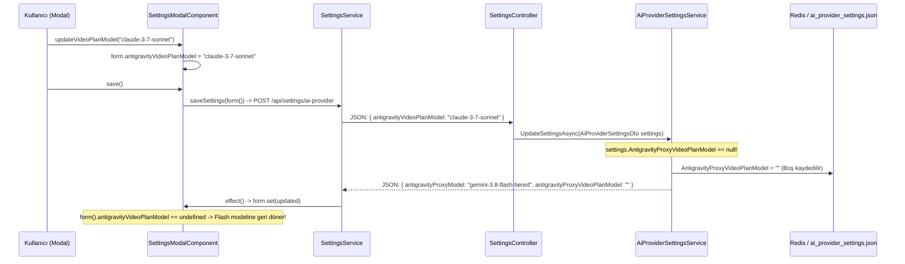
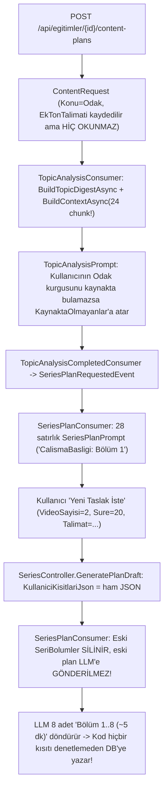

# DOK2 — Mevcut Kod Debug ve Akış Raporu (Şu Anki Sistem Nasıl Çalışıyor?)

> **4'lü Dokümantasyon Navigasyonu:**
> - [DOK1 — Hedef ve Gereksinimler](file:///d:/Hoca/VideoOzet/docs/DOK1_HEDEF_VE_GEREKSINIMLER.md)
> - **[DOK2 — Mevcut Kod Debug ve Akış Raporu (Aktif)](file:///d:/Hoca/VideoOzet/docs/DOK2_MEVCUT_KOD_DEBUG_VE_AKIS_RAPORU.md)**
> - [DOK3 — Endüstri, Benzer Projeler ve Literatür Araştırması](file:///d:/Hoca/VideoOzet/docs/DOK3_ENDUSTRI_VE_BENZER_PROJELER_ARASTIRMASI.md)
> - [DOK4 — Adım Adım Geliştirme Planı](file:///d:/Hoca/VideoOzet/docs/DOK4_ADIM_ADIM_GELISTIRME_PLANI.md)

---

## 1. Akış 1 — Model Seçimi, Kayıt ve Çağrı Zinciri Debug Analizi

### 1.1. Arayüzden Backend'e Çağrı Sırası ve Değişken İzlemesi



1. **Adım 1 — Arayüz Modeli:** [settings.service.ts](file:///d:/Hoca/VideoOzet/src/VideoOzet.UI/src/app/core/services/settings.service.ts#L6-L25) içindeki `AiProviderSettings` arayüzü Yerel Proxy görev modellerini `antigravitySummaryModel`, `antigravityVideoPlanModel` ve `antigravityQcModel` olarak tanımlar.
2. **Adım 2 — Modal Güncellemesi:** Kullanıcı modalda *"2. Video Planı, Senaryo & Revizyon Modeli"* seçtiğinde veya hazır şablona (`applyPreset`) tıkladığında [settings-modal.component.ts](file:///d:/Hoca/VideoOzet/src/VideoOzet.UI/src/app/shared/components/settings-modal/settings-modal.component.ts#L693-L730) içinde `updateVideoPlanModel(val)` çalışır ve `this.updateField('antigravityVideoPlanModel', val)` çağrılır.
3. **Adım 3 — Backend Deserializasyon Çöküşü:** `POST /api/settings/ai-provider` ([SettingsController.cs](file:///d:/Hoca/VideoOzet/src/VideoOzet.API/Controllers/SettingsController.cs#L27-L34)) gövdeyi [IAiProviderSettingsService.cs](file:///d:/Hoca/VideoOzet/src/VideoOzet.Business/Interfaces/IAiProviderSettingsService.cs#L54-L61) içindeki `AiProviderSettingsDto` kaydına bağlar. Ancak C# tarafındaki özellik adları:
   - `AntigravityProxySummaryModel`
   - `AntigravityProxyVideoPlanModel`
   - `AntigravityProxyQcModel`
   şeklindedir. İsimler eşleşmediği için üç alan da `null` gelir!
4. **Adım 4 — Boş Kayıt ve Flash'a Geri Dönüş:** [AiProviderSettingsService.cs](file:///d:/Hoca/VideoOzet/src/VideoOzet.Business/Services/AiProviderSettingsService.cs#L135-L137) `settings.AntigravityProxyVideoPlanModel` boş olduğu için eski boş değeri korur. Redis `videoozet:settings:ai_provider` kaydında ve `ai_provider_settings.json` dosyasında bizzat doğrulandığı üzere `AntigravityProxyVideoPlanModel = ""` kalmıştır. Yanıt döndüğünde [settings-modal.component.ts](file:///d:/Hoca/VideoOzet/src/VideoOzet.UI/src/app/shared/components/settings-modal/settings-modal.component.ts#L672-L677) içindeki `activeVideoPlanModel` hesaplanmış sinyali `f.antigravityVideoPlanModel || f.antigravityProxyModel` ifadesinden dolayı tekrar Flash modeline döner.
5. **Adım 5 — Üst Bar Rozet Hatası:** [navbar.component.ts](file:///d:/Hoca/VideoOzet/src/VideoOzet.UI/src/app/shared/components/navbar/navbar.component.ts#L68-L73) görev modelini (`VideoPlanModel`) hiç okumaz; doğrudan `openRouterModel` / `groqModel` / `antigravityProxyModel` değerini ekrana basar.
6. **Adım 6 — Sessiz Groq Fallback ve 5.800 Karakter Budaması:** [ClaudeSynthesisProvider.cs](file:///d:/Hoca/VideoOzet/src/VideoOzet.Business/Infrastructure/AI/ClaudeSynthesisProvider.cs#L395-L505) içinde yerel proxy tek anahtarla `maxRetries = 1` çalışır; tek bir timeout veya HTTP hatasında `break` ile çıkıp [satır 509-577](file:///d:/Hoca/VideoOzet/src/VideoOzet.Business/Infrastructure/AI/ClaudeSynthesisProvider.cs#L509-L577) arasındaki Groq yedek döngüsüne girer. Burada `CompactPromptForGroq(prompt, 9500 -> 7200 -> 5800)` çağrılarak 80.000 karakterlik kaynak bağlamının %90'ı kesilir (`[...]`). Veritabanındaki `BolumRevizyonlari` (`SeriBolumId = 4aa40158...`, `RevizyonNo = 3`) kaydının sonunda bu `[...]` kesik kaynak bloklarının model tarafından çıktıya kopyalandığı bizzat görülmüştür.

---

## 2. Akış 2 — Kaynak Yükleme, Özetleme, Çeviri ve Vektör İndeksleme Debug Analizi

1. **Doküman Metin Çıkarımı ve %80 Veri Kaybı:**
   - Dosya yüklendiğinde [DosyalarController.cs](file:///d:/Hoca/VideoOzet/src/VideoOzet.API/Controllers/DosyalarController.cs#L53-L56) → [DokumanService.cs](file:///d:/Hoca/VideoOzet/src/VideoOzet.Business/Services/DokumanService.cs#L42-L86) `DocumentUploadedEvent` fırlatır.
   - [ExtractDokumanTextConsumer.cs](file:///d:/Hoca/VideoOzet/src/VideoOzet.Worker/Consumers/ExtractDokumanTextConsumer.cs#L146-L147) dokümanın tam metni (`extractedText`, örn. 120.000 kr) yerine `BuildRepresentativeSample(extractedText, 22000)` fonksiyonuyla ([satır 344-374](file:///d:/Hoca/VideoOzet/src/VideoOzet.Worker/Consumers/ExtractDokumanTextConsumer.cs#L344-L374)) baştan 8.000 + ortadan 5.000 + 5.000 + sondan 4.000 kr alır ve `SummarizeAsync` çağırır.
   - Dokümanın kalan **%80'lik kısmı** ne `DamitilmisOzetMetni` ne de `CevrilmisOzetMetni` içine girer!
2. **Konu Haritasında (`SourceTopicMapper`) Kesik Özete Bakılması:**
   - [SourceTopicMapper.cs](file:///d:/Hoca/VideoOzet/src/VideoOzet.Business/Services/SourceTopicMapper.cs#L150-L155) doküman konularını çıkarırken:
     ```csharp
     var docText = (!string.IsNullOrWhiteSpace(doc.DokumanMetin!.CevrilmisOzetMetni)
         ? doc.DokumanMetin.CevrilmisOzetMetni
         : !string.IsNullOrWhiteSpace(doc.DokumanMetin.DamitilmisOzetMetni)
             ? doc.DokumanMetin.DamitilmisOzetMetni
             : doc.DokumanMetin.HamMetin ?? "").Trim();
     ```
     sırasını izler. `DamitilmisOzetMetni` dolu olduğu için `HamMetin`'e **hiçbir zaman inmez** ve yalnızca 22K örneklemin özetinden konu çıkarır!
3. **Video STT ve Özetleme Kırılganlıkları:**
   - [GroqWhisperSttProvider.cs](file:///d:/Hoca/VideoOzet/src/VideoOzet.Business/Infrastructure/AI/GroqWhisperSttProvider.cs#L94-L127) `response_format = "verbose_json"` göndermesine rağmen yanıt JSON'ındaki `segments` dizisini hiç okumaz; [CompositeSttProvider.cs](file:///d:/Hoca/VideoOzet/src/VideoOzet.Business/Infrastructure/AI/CompositeSttProvider.cs#L91-L95) içinde `LastSegmentsJson` `null` kalır.
   - [GeminiSummarizer.cs](file:///d:/Hoca/VideoOzet/src/VideoOzet.Business/Infrastructure/AI/GeminiSummarizer.cs#L59-L85) tüm transkripti tek JSON string içinde damıtmak ister; `finish_reason` kontrolü yoktur. Uzun videoda JSON yarım kalırsa [SummarizeVideoConsumer.cs](file:///d:/Hoca/VideoOzet/src/VideoOzet.Worker/Consumers/SummarizeVideoConsumer.cs#L124-L136) `catch` bloğunda ham (bozuk) metni kaydeder ve `detectedLang` varsayılan `"tr"` kaldığı için yabancı dil çevirisi tetiklenmez.
4. **`KullanimTuru` Değişikliğinin Vektör Tablosuna Yansımaması:**
   - İndeksleme anında [ContextualTextChunker.cs](file:///d:/Hoca/VideoOzet/src/VideoOzet.Business/Infrastructure/AI/ContextualTextChunker.cs#L419-L420) her parçanın `Text` alanının başına `[Kaynak: ... | Mod: DOĞRUDAN REFERANS]` yazar ve [IndexDokumanConsumer.cs](file:///d:/Hoca/VideoOzet/src/VideoOzet.Worker/Consumers/IndexDokumanConsumer.cs#L208) `KullanimTuru` sütununu doldurur.
   - Kullanıcı daha sonra arayüzden modu değiştirdiğinde [VideoManager.cs](file:///d:/Hoca/VideoOzet/src/VideoOzet.Business/Services/VideoManager.cs#L393-L403) ve [DokumanService.cs](file:///d:/Hoca/VideoOzet/src/VideoOzet.Business/Services/DokumanService.cs#L294-L303) sadece `Videolar` / `Dokumanlar` tablosunu günceller; `VideoChunkDocuments` içindeki gömülü metin başlığı eski modda kalarak promptta çelişki üretir.
5. **Sabit Çapraz Dil Sözlüğü:**
   - [QueryDecomposer.cs](file:///d:/Hoca/VideoOzet/src/VideoOzet.Business/Services/QueryDecomposer.cs#L23-L61) içindeki `CrossLingualDictionary` yalnızca özgür irade/algoritma terimlerinden oluşan 36 sabit satırdır; başka konularda yabancı kaynaklarla sözcüksel eşleşme kuramaz.

---

## 3. Akış 3 — Akıllı Seri Planlama ve Plan Revizyonu Debug Analizi



### Canlı Veritabanı Kanıtı (`ContentRequestId = 1c637838-ea91-4ccf-9f2d-21152a52004c`)
- **Eğitim Kaynak Havuzu (`bd08000a...`):** 31 doküman (`1.060.411` kr) + 15 video (`409.072` kr) = **46 kaynak (`1.469.483` kr)**.
- **Kullanıcının Girdiği Kısıt (`SeriPlani.KullaniciKisitlariJson`):**
  `{"VideoSayisi":2,"VarsayilanSureDk":20,"Talimat":"1. vido çok daha ayrıntılı olmalı daha faza kişiden bahsetmeli ve hepsinii daha açıklayıcı anlatımlarını yapan bölümler olmalı"}`
- **Sistemin Kaydettiği Sonuç (`SeriPlaniId = e5641b02...`):**
  `VideoSayisi = 8`, bölümler: `"Bölüm 1" (5 dk)`, `"Bölüm 2" (5 dk)`, `"Bölüm 3" (5 dk)` ... `"Bölüm 8" (5 dk)`!

### Satır Satır Hata Noktaları:
1. **`EkTonTalimati` Ölü Alanı:** [SeriesController.cs](file:///d:/Hoca/VideoOzet/src/VideoOzet.API/Controllers/SeriesController.cs#L44) ile kaydedilen `request.EkTonTalimati` hiçbir consumer içinde okunmaz.
2. **Önceki Taslağın Silinip LLM'den Gizlenmesi:** [SeriesPlanConsumer.cs](file:///d:/Hoca/VideoOzet/src/VideoOzet.Worker/Consumers/SeriesPlanConsumer.cs#L88-L89) yeni taslak üretmeden hemen önce `_dbContext.SeriBolumler.RemoveRange(seriPlani.SeriBolumler)` çalıştırır ve [satır 153-159](file:///d:/Hoca/VideoOzet/src/VideoOzet.Worker/Consumers/SeriesPlanConsumer.cs#L153-L159)'daki `GenerateSeriesPlanAsync` çağrısına eski planı (`SeriHaritasiJson`) **hiç geçirmez**.
3. **Kısıt Zorlama Eksikliği:** [SeriesPlanConsumer.cs](file:///d:/Hoca/VideoOzet/src/VideoOzet.Worker/Consumers/SeriesPlanConsumer.cs#L167-L204) `KullaniciKisitlariJson` içindeki `VideoSayisi` ve `VarsayilanSureDk` alanlarını deserialize bile etmez; LLM'in döndürdüğü diziyi olduğu gibi kaydeder.
4. **Yanıltıcı Prompt Şablonu:** [PromptTemplates.cs](file:///d:/Hoca/VideoOzet/src/VideoOzet.Business/Helpers/PromptTemplates.cs#L329-L337) içindeki `SeriesPlanPrompt` JSON örneğinde `"CalismaBasligi": "Bölüm 1"` yazdığı için Flash modeli başlık üretmek yerine `"Bölüm 1"` yazmaktadır.
5. **Onay Sırasında JSON Bozulması:** [SeriesController.cs](file:///d:/Hoca/VideoOzet/src/VideoOzet.API/Controllers/SeriesController.cs#L214-L225) `ApprovePlan` metodunda `plan.KullaniciKisitlariJson += "\n" + talimat;` satırı geçerli JSON yapısını bozar.
6. **Sahte Harita Düzenleme Ucu:** [SeriesController.cs](file:///d:/Hoca/VideoOzet/src/VideoOzet.API/Controllers/SeriesController.cs#L351-L370) `UpdatePlanTexts` yalnızca `SeriHaritasiJson` alanını günceller, `SeriBolumler` tablosuna dokunmaz; [series-map.component.ts](file:///d:/Hoca/VideoOzet/src/VideoOzet.UI/src/app/features/series-map/series-map.component.ts#L18-L75) ise tamamen salt-okunurdur.

---

## 4. Akış 4 — Bölüm Video Metni Üretimi, RAG Kota Darboğazı ve QC Silicisi Debug Analizi

1. **46 Kaynağa Karşı Sabit 24 Parça (Chunk) Sınırı:**
   - [SeriesVideoGenerationConsumer.cs](file:///d:/Hoca/VideoOzet/src/VideoOzet.Worker/Consumers/SeriesVideoGenerationConsumer.cs#L136-L140) `_sourceContextBuilder.BuildContextAsync(..., maxChars: 80000)` çağırır.
   - Ancak [SourceContextBuilder.cs](file:///d:/Hoca/VideoOzet/src/VideoOzet.Business/Services/SourceContextBuilder.cs#L25) içinde `private const int GlobalTargetChunks = 24;` sabittir! `maxChars` 80.000 olsa bile 24 parça (~35.000 kr) seçildiğinde döngü durur ve 46 kaynağın **30'undan fazlası bağlama hiç giremez**.
2. **Detaylı Senaryo Promptunun Atlanması ve Sürenin Sabit `"10-15 Dakika"` Ezilmesi:**
   - [SeriesVideoGenerationConsumer.cs](file:///d:/Hoca/VideoOzet/src/VideoOzet.Worker/Consumers/SeriesVideoGenerationConsumer.cs#L162-L169) `GenerateSeriesVideoContentAsync` metoduna ne `bolum.HedefSureDk` (20 dk), ne `bolum.AnaFikir`, ne de `request.Konu` (kullanıcının ana kurgusu) değerini gönderir!
   - [ClaudeSynthesisProvider.cs](file:///d:/Hoca/VideoOzet/src/VideoOzet.Business/Infrastructure/AI/ClaudeSynthesisProvider.cs#L830-L838):
     ```csharp
     var arastirmaOzeti = await GenerateResearchSummaryAsync(bolumBasligi, "Uzun ve Detaylı (10-15 Dakika)", targetAudience, fullContext, ct);
     var videoPlani = await GenerateGroundedVideoPlanAsync(bolumBasligi, "10-15 Dakika", fullContext, arastirmaOzeti, ct);
     return JsonSerializer.Serialize(new { ArastirmaOzeti = arastirmaOzeti, VideoPlani = videoPlani, DevirNotu = $"{bolumBasligi} işlendi." });
     ```
     Görüldüğü gibi:
     - [PromptTemplates.cs](file:///d:/Hoca/VideoOzet/src/VideoOzet.Business/Helpers/PromptTemplates.cs#L340-L471) içindeki 130 satırlık `SeriesVideoGenerationPrompt` **hiç kullanılmaz**.
     - Çağrılan `SynthesisVideoPlanGroundedPrompt` ([PromptTemplates.cs](file:///d:/Hoca/VideoOzet/src/VideoOzet.Business/Helpers/PromptTemplates.cs#L98-L118)) sadece 20 satırdır; sahne sayısı, paragraf uzunluğu ve kelime hedefi içermez.
     - `DevirNotu` sahte olarak `$"{bolumBasligi} işlendi."` atanır.
3. **Kullanıcı Yorumunun QC Auto-Refine Tarafından Silinmesi:**
   - [PromptTemplates.cs](file:///d:/Hoca/VideoOzet/src/VideoOzet.Business/Helpers/PromptTemplates.cs#L15) (`SynthesisResearchPrompt` Kural 1) ve `BatchQcPrompt` ([satır 205-226](file:///d:/Hoca/VideoOzet/src/VideoOzet.Business/Helpers/PromptTemplates.cs#L205-L226)) kullanıcının kendi tezini/yorumunu kaynak iddialarından ayırmaz.
   - [SeriesVideoGenerationConsumer.cs](file:///d:/Hoca/VideoOzet/src/VideoOzet.Worker/Consumers/SeriesVideoGenerationConsumer.cs#L237-L252) `qcResult.DesteklenmeyenSayisi > 0` olduğunda *"desteklenmediği saptanan iddiaları tamamen çıkar"* talimatıyla hem özeti hem video planını yeniden yazdırarak kullanıcının özellikle eklettiği ancak `[K#]` içinde yer almayan kavramsal bölümleri siler.
4. **Bölüm Revizyonunda Eski 24 Chunk'a Hapsolma ve Sahte QC:**
   - [SeriesVideoRevisionConsumer.cs](file:///d:/Hoca/VideoOzet/src/VideoOzet.Worker/Consumers/SeriesVideoRevisionConsumer.cs#L89-L93) `previousChunkIds.Any()` doğru olduğu sürece `BuildFromChunkIdsAsync` ile hep ilk üretimdeki 24 parçayı yükler; [satır 96](file:///d:/Hoca/VideoOzet/src/VideoOzet.Worker/Consumers/SeriesVideoRevisionConsumer.cs#L96)'daki dinamik arama `if (string.IsNullOrWhiteSpace(contextData))` koşulu yüzünden **hiçbir zaman çalışmaz!**
   - Ayrıca [satır 198-203](file:///d:/Hoca/VideoOzet/src/VideoOzet.Worker/Consumers/SeriesVideoRevisionConsumer.cs#L198-L203) `videoPlanText` parametresini geçirmediği için revize edilen senaryo denetlenmez; hata düşerse [satır 222-230](file:///d:/Hoca/VideoOzet/src/VideoOzet.Worker/Consumers/SeriesVideoRevisionConsumer.cs#L222-L230) sahte `"desteklendi"` JSON'u yazar; sonraki bölümlerin `BaglamEskidi` bayrağına da hiç dokunmaz.
