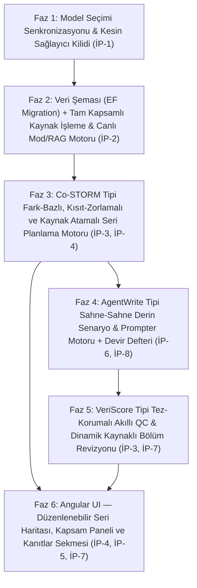

# DOK4 — Adım Adım Geliştirme Planı (Nasıl Geliştireceğiz?)

> **4'lü Dokümantasyon Navigasyonu:**
> - [DOK1 — Hedef ve Gereksinimler](file:///d:/Hoca/VideoOzet/docs/DOK1_HEDEF_VE_GEREKSINIMLER.md)
> - [DOK2 — Mevcut Kod Debug ve Akış Raporu](file:///d:/Hoca/VideoOzet/docs/DOK2_MEVCUT_KOD_DEBUG_VE_AKIS_RAPORU.md)
> - [DOK3 — Endüstri, Benzer Projeler ve Literatür Araştırması](file:///d:/Hoca/VideoOzet/docs/DOK3_ENDUSTRI_VE_BENZER_PROJELER_ARASTIRMASI.md)
> - **[DOK4 — Adım Adım Geliştirme Planı (Aktif)](file:///d:/Hoca/VideoOzet/docs/DOK4_ADIM_ADIM_GELISTIRME_PLANI.md)**

---

## 1. Faz Sırası ve Bağımlılık Diyagramı

[DOK1](file:///d:/Hoca/VideoOzet/docs/DOK1_HEDEF_VE_GEREKSINIMLER.md) içindeki 8 iş paketini (`İP-1`..`İP-8`), [DOK2](file:///d:/Hoca/VideoOzet/docs/DOK2_MEVCUT_KOD_DEBUG_VE_AKIS_RAPORU.md)'deki hata noktalarını kırıp [DOK3](file:///d:/Hoca/VideoOzet/docs/DOK3_ENDUSTRI_VE_BENZER_PROJELER_ARASTIRMASI.md)'teki mimari modelleri devreye alacak şekilde birbirine bağımlı **6 sıralı fazda** uygulayacağız:



---

## 2. Kullanılacak Teknolojiler ve Mevcut Altyapı Uyumluluğu

* **Backend & Worker:** .NET 10, ASP.NET Core Web API, MassTransit (RabbitMQ / InMemory), Entity Framework Core + Npgsql (`pgvector` + PostgreSQL Full-Text Search `tsvector`), StackExchange.Redis, SignalR.
* **Frontend:** Angular (Standalone Components, Signals, TailwindCSS, `marked`, `docx` yerel paragraf üreticisi).
* **Ek Kütüphane Gereksinimi Yok:** Tüm yeni algoritmalar (Kota-Kısıtlı RRF+MMR, Fark-Bazlı Plan Yamalama, Sahne-Sahne İteratif Yazım, VeriScore Çift Katmanlı QC, FFmpeg ses dilimleme) mevcut yığın üzerinde harici paket bağımlılığı eklemeden temiz C# ve TypeScript servisleriyle uygulanacaktır.

---

## 3. Faz Bazlı Teknik Uygulama Detayları, Veri Yapıları ve Fonksiyon İmzaları

### FAZ 1 — Model Seçimi Senkronizasyonu ve Kesin Sağlayıcı Kilidi (`İP-1` | `DOK2 §1`)

#### Değişecek Dosyalar
1. [IAiProviderSettingsService.cs](file:///d:/Hoca/VideoOzet/src/VideoOzet.Business/Interfaces/IAiProviderSettingsService.cs)
2. [AiProviderSettingsService.cs](file:///d:/Hoca/VideoOzet/src/VideoOzet.Business/Services/AiProviderSettingsService.cs)
3. [ClaudeSynthesisProvider.cs](file:///d:/Hoca/VideoOzet/src/VideoOzet.Business/Infrastructure/AI/ClaudeSynthesisProvider.cs)
4. [GeminiSummarizer.cs](file:///d:/Hoca/VideoOzet/src/VideoOzet.Business/Infrastructure/AI/GeminiSummarizer.cs)
5. [DokumanService.cs](file:///d:/Hoca/VideoOzet/src/VideoOzet.Business/Services/DokumanService.cs)
6. [settings.service.ts](file:///d:/Hoca/VideoOzet/src/VideoOzet.UI/src/app/core/services/settings.service.ts)
7. [settings-modal.component.ts](file:///d:/Hoca/VideoOzet/src/VideoOzet.UI/src/app/shared/components/settings-modal/settings-modal.component.ts)
8. [navbar.component.ts](file:///d:/Hoca/VideoOzet/src/VideoOzet.UI/src/app/shared/components/navbar/navbar.component.ts)

#### Veri Yapısı ve İmza Değişiklikleri
* **`AiProviderSettingsDto` ([IAiProviderSettingsService.cs](file:///d:/Hoca/VideoOzet/src/VideoOzet.Business/Interfaces/IAiProviderSettingsService.cs)):**
  - Hem geriye uyumluluk hem tam eşleşme için `[JsonPropertyName]` / çift yönlü alias desteği ve **`AllowFallbackToSecondaryProvider`** (`bool`, varsayılan: `false`) alanı eklenecek:
    ```csharp
    public string? AntigravityProxySummaryModel { get; set; }
    public string? AntigravityProxyVideoPlanModel { get; set; }
    public string? AntigravityProxyQcModel { get; set; }
    public bool AllowFallbackToSecondaryProvider { get; set; } = false;
    ```
  - TypeScript `AiProviderSettings` ([settings.service.ts](file:///d:/Hoca/VideoOzet/src/VideoOzet.UI/src/app/core/services/settings.service.ts)) alan adları `antigravityProxySummaryModel`, `antigravityProxyVideoPlanModel`, `antigravityProxyQcModel` ve `allowFallbackToSecondaryProvider` ile birebir hizalanacak.
* **`NavbarComponent` ([navbar.component.ts](file:///d:/Hoca/VideoOzet/src/VideoOzet.UI/src/app/shared/components/navbar/navbar.component.ts)):**
  - Üst bardaki rozette aktif **Plan/Senaryo Modeli** (ör. `Plan: claude-3-7-sonnet | Özet: gemini-3.8-flash`) açıkça gösterilecek.
* **`ClaudeSynthesisProvider.CallLlmRawAsync` & `GeminiSummarizer.ExecuteLlmPromptAsync`:**
  - Yerel Proxy ve OpenRouter çağrılarında geçici ağ/yoğunluk hatalarına karşı `maxRetries = Math.Max(apiKeys.Length, 3)` + üstel bekleme uygulanacak.
  - `settings.AllowFallbackToSecondaryProvider == false` iken seçili sağlayıcı başarısız olursa **kesinlikle sessizce Groq 5.800 kr sıkıştırılmış moduna düşmeyecek**; seçili modelin neden hata verdiğini net mesajla döndürecek.
  - [DokumanService.cs](file:///d:/Hoca/VideoOzet/src/VideoOzet.Business/Services/DokumanService.cs#L322) içindeki sahte `"gemini-1.5-flash"` kaldırılıp `DokumanMetin.LlmModel` gerçek model adıyla doldurulacak.

---

### FAZ 2 — Veritabanı Şeması, Eksiksiz Kaynak İşleme ve Kota-Kısıtlı Hiyerarşik RAG (`İP-2` | `DOK2 §2, §4` | `DOK3 §2.3`)

#### Değişecek Dosyalar
1. [SeriBolum.cs](file:///d:/Hoca/VideoOzet/src/VideoOzet.Data/Entities/SeriBolum.cs) & [SeriBolumConfiguration.cs](file:///d:/Hoca/VideoOzet/src/VideoOzet.Data/Configurations/SeriBolumConfiguration.cs)
2. [SeriPlani.cs](file:///d:/Hoca/VideoOzet/src/VideoOzet.Data/Entities/SeriPlani.cs)
3. [DokumanMetin.cs](file:///d:/Hoca/VideoOzet/src/VideoOzet.Data/Entities/DokumanMetin.cs)
4. Yeni EF Core Migration (`AddSeriesRichPlanningAndSourceAssignment`)
5. [ExtractDokumanTextConsumer.cs](file:///d:/Hoca/VideoOzet/src/VideoOzet.Worker/Consumers/ExtractDokumanTextConsumer.cs)
6. [SourceTopicMapper.cs](file:///d:/Hoca/VideoOzet/src/VideoOzet.Business/Services/SourceTopicMapper.cs)
7. [GroqWhisperSttProvider.cs](file:///d:/Hoca/VideoOzet/src/VideoOzet.Business/Infrastructure/AI/GroqWhisperSttProvider.cs) & [CompositeSttProvider.cs](file:///d:/Hoca/VideoOzet/src/VideoOzet.Business/Infrastructure/AI/CompositeSttProvider.cs)
8. [ContextualTextChunker.cs](file:///d:/Hoca/VideoOzet/src/VideoOzet.Business/Infrastructure/AI/ContextualTextChunker.cs)
9. [VideoManager.cs](file:///d:/Hoca/VideoOzet/src/VideoOzet.Business/Services/VideoManager.cs), [DokumanService.cs](file:///d:/Hoca/VideoOzet/src/VideoOzet.Business/Services/DokumanService.cs), [EgitimManager.cs](file:///d:/Hoca/VideoOzet/src/VideoOzet.Business/Services/EgitimManager.cs)
10. [ISourceContextBuilder.cs](file:///d:/Hoca/VideoOzet/src/VideoOzet.Business/Services/ISourceContextBuilder.cs), [SourceContextBuilder.cs](file:///d:/Hoca/VideoOzet/src/VideoOzet.Business/Services/SourceContextBuilder.cs), [QueryDecomposer.cs](file:///d:/Hoca/VideoOzet/src/VideoOzet.Business/Services/QueryDecomposer.cs)

#### Eklenecek Entity Alanları ve Fonksiyon İmzaları
* **`SeriBolum` Entity Genişletmesi:**
  ```csharp
  public string Kanca { get; set; } = string.Empty;             // Bölümün izleyiciyi yakalayan açılış sorusu/vaadi
  public string SahneIskeletiJson { get; set; } = "[]";         // Bölüm içi alt sahneler, süreler ve işlenecek düşünürler
  public string AtananKaynaklarJson { get; set; } = "[]";       // Bu bölüme atanan Video/Doküman ID ve başlıkları
  ```
* **`SeriPlani` Entity Genişletmesi:**
  ```csharp
  public string OnayTalimati { get; set; } = string.Empty;      // KullaniciKisitlariJson'ı bozmadan onay notunu ayrı tutar
  ```
* **`DokumanMetin` Entity Genişletmesi:**
  ```csharp
  public string? LlmModel { get; set; }                         // Gerçek özetleyen model adı
  ```
* **Tam Kapsamlı Kaynak Konu Haritası (`SourceTopicMapper`):**
  - `SourceTopicMapper.BuildTopicDigestAsync` artık dokümanlarda 22K kesik özeti değil, doğrudan `HamMetin` (parçalı `MaxWordsPerChunk = 18000` pencereleriyle) + yabancı dildeyse çevrilmiş konu başlıklarını tarayarak hiçbir sayfayı atlamayacak; `PromptVersiyonu = 2` yapılarak eski eksik önbellekler otomatik yenilenecek.
  - Yeni yapılandırılmış metot eklenecek:
    ```csharp
    Task<IReadOnlyList<CourseSourceCardDto>> GetStructuredSourceCardsAsync(Guid egitimId, CancellationToken ct = default);
    ```
* **Kota-Kısıtlı Hiyerarşik `SourceContextBuilder` ([DOK3 §2.3](file:///d:/Hoca/VideoOzet/docs/DOK3_ENDUSTRI_VE_BENZER_PROJELER_ARASTIRMASI.md)):**
  ```csharp
  Task<SourceContextResult> BuildContextAsync(
      Guid egitimId,
      IEnumerable<string> queries,
      int maxChars = 120000,
      CancellationToken ct = default,
      IReadOnlyCollection<Guid>? preferredSourceIds = null,
      int? targetChunksOverride = null);
  ```
  - `preferredSourceIds` (bölüme atanan kaynaklar) verildiğinde önce **atanan her kaynaktan en iyi en az 1 parça** garanti edilecek, toplam chunk hedefi kaynak sayısına göre dinamik (`30..64`) ölçeklenecek.
  - `ContextualTextChunker.BuildHeader` içinden sabit `| Mod: ...` kaldırılacak (veya `SourceContextBuilder.PopulateFormattedResult` sırasında eski gömülü `Mod:` etiketi temizlenip güncel `ResolveMode` değeri basılacak); `UpdateKullanimTuruAsync` çağrıldığında `VideoChunkDocuments.KullanimTuru` da toplu güncellenecek.
* **Groq STT & Dinamik Çapraz Dil Arama:**
  - `GroqWhisperSttProvider` yanıtındaki `segments` dizisini `LastSegmentsJson` olarak kaydedecek; >20 MB ses dosyalarında FFmpeg ile 15 dakikalık dilimlere bölerek zaman ofsetli birleştirme yapacak.
  - `QueryDecomposer` yabancı kaynaklı eğitimlerde sabit 36 kelimelik sözlüğe ek olarak hızlı özet modeliyle sorguya özgü İngilizce/yabancı anahtar terim genişletmesi yapacak.

---

### FAZ 3 — Fark-Bazlı, Kısıt-Zorlamalı ve Kaynak Atamalı Seri Planlama Motoru (`İP-3, İP-4, İP-5` | `DOK3 §2.1`)

#### Değişecek Dosyalar
1. [SeriesDtos.cs](file:///d:/Hoca/VideoOzet/src/VideoOzet.Business/DTOs/SeriesDtos.cs)
2. [ISynthesisProvider.cs](file:///d:/Hoca/VideoOzet/src/VideoOzet.Business/Interfaces/ISynthesisProvider.cs) & [ClaudeSynthesisProvider.cs](file:///d:/Hoca/VideoOzet/src/VideoOzet.Business/Infrastructure/AI/ClaudeSynthesisProvider.cs)
3. [PromptTemplates.cs](file:///d:/Hoca/VideoOzet/src/VideoOzet.Business/Helpers/PromptTemplates.cs)
4. [TopicAnalysisConsumer.cs](file:///d:/Hoca/VideoOzet/src/VideoOzet.Worker/Consumers/TopicAnalysisConsumer.cs)
5. [SeriesPlanConsumer.cs](file:///d:/Hoca/VideoOzet/src/VideoOzet.Worker/Consumers/SeriesPlanConsumer.cs)
6. [SeriesController.cs](file:///d:/Hoca/VideoOzet/src/VideoOzet.API/Controllers/SeriesController.cs)

#### Uygulama Adımları ve İmzalar
1. **`TopicAnalysisPrompt` & `TopicAnalysisConsumer`:**
   - `request.Konu` (kullanıcının kurgu/tez metni) ve `request.EkTonTalimati` açıkça **`[YAZAR-TEZİ VE KURGU DİREKTİFİ]`** olarak prompta verilecek; kullanıcının tezleri `KaynaktaOlmayanlar`'a atılıp dışlanmayacak, aksine tüm kaynak kartları bu tezin bölümlerine hizmet edecek şekilde haritalanacak.
2. **Fark-Bazlı `GenerateSeriesPlanAsync` İmzası:**
   ```csharp
   Task<string> GenerateSeriesPlanAsync(
       string topicAndThesis,
       string targetAudience,
       string toneInstruction,
       string konuAnaliziJson,
       string structuredSourceCardsJson,
       string formattedConstraintsText,
       string previousPlanJson = "",
       CancellationToken ct = default);
   ```
3. **Zengin JSON Plan Şeması & Deterministik Kısıt Denetleyicisi (`SeriesPlanConsumer`):**
   - Her bölüm için `CalismaBasligi` (*"Bölüm 1" gibi jenerik isim kesinlikle yasak!*), `Kanca`, `HedefSureDk`, `AnaFikir` (en az 3–4 cümle kapsamlı açıklama), `Konular` (açıklamalı maddeler), `SahneIskeleti` (sahne başlığı + dakika + işlenecek düşünür/kavramlar) ve `AtananKaynakIdleri` üretilecek.
   - **C# Kısıt Zorlayıcı (`EnforcePlanConstraintsAsync`):**
     - `SeriesDraftDto.VideoSayisi` belirtilmişse (ör. `2`) ve LLM'in döndürdüğü `SeriHaritasi.Count != 2` ise sistem eksikliği açıklayan tek atımlık düzeltme çağrısı yapacak; yine uymazsa deterministik birleştirme/bölme uygulayacak.
     - `SeriesDraftDto.VarsayilanSureDk` (ör. `20`) ve `VideoSureleri` sözlüğü doğrudan C# tarafında bölüm sürelerine zorunlu atanacak.
     - Eski plan silinmeden önce `previousPlanJson` olarak saklanıp LLM'e verilecek; böylece *"1. videoyu genişlet"* gibi göreceli revizyonlar birebir çalışacak.
4. **Gerçek Harita Düzenleme API'si (`PUT api/content-plans/{id}/plans/{planNo}`):**
   - `UpdatePlanDto` tanımlanarak gelen bölüm güncellemeleri (başlık, süre, kanca, ana fikir, konular, sahne iskeleti, atanan kaynaklar, yeni/silinen bölüm) doğrudan `SeriBolumler` tablosuna kaydedilecek.

---

### FAZ 4 — Sahne-Sahne (Iterative) Derin Video Senaryo Motoru ve Devir Defteri (`İP-6, İP-8` | `DOK3 §2.2`)

#### Değişecek Dosyalar
1. [PromptTemplates.cs](file:///d:/Hoca/VideoOzet/src/VideoOzet.Business/Helpers/PromptTemplates.cs)
2. [ISynthesisProvider.cs](file:///d:/Hoca/VideoOzet/src/VideoOzet.Business/Interfaces/ISynthesisProvider.cs) & [ClaudeSynthesisProvider.cs](file:///d:/Hoca/VideoOzet/src/VideoOzet.Business/Infrastructure/AI/ClaudeSynthesisProvider.cs)
3. [SeriesVideoGenerationConsumer.cs](file:///d:/Hoca/VideoOzet/src/VideoOzet.Worker/Consumers/SeriesVideoGenerationConsumer.cs)
4. [GenerateContentConsumer.cs](file:///d:/Hoca/VideoOzet/src/VideoOzet.Worker/Consumers/GenerateContentConsumer.cs)

#### Uygulama Adımları ve İmzalar
1. **Yeni `SeriesEpisodeGenerationRequest` Modeli:**
   ```csharp
   public sealed record SeriesEpisodeGenerationRequest(
       int BolumNo,
       int ToplamBolumSayisi,
       string CalismaBasligi,
       string Kanca,
       string BolumAnaFikri,
       int HedefSureDk,
       string BolumKonulariJson,
       string SahneIskeletiJson,
       string YazarTeziVeGenelOdak,
       string EkTonTalimati,
       string OnayTalimati,
       string OncekiBolumDevirDefteriJson,
       string HedefKitle,
       string KaynakBaglamiText);
   ```
2. **3 Aşamalı AgentWrite Üretim Boru Hattı (`GenerateSeriesEpisodeAsync`):**
   - **Adım A — Kapsamlı Araştırma Özeti & Sahne Planı (`HedefSureDk` Uyumlu):**
     `HedefSureDk` değerine göre toplam kelime hedefi ($W = 140 \times \text{HedefSureDk}$) ve sahne listesi ($S = \max(5, \lceil \text{HedefSureDk} / 3.0 \rceil)$) oluşturulur; hem `[K#]` kanıtları hem `[YAZAR-TEZİ]` argümanları ilgili sahnelere dağıtılır.
   - **Adım B — İteratif Sahne Yazımı:**
     Sahneler 2'şerli gruplar halinde yazılır. Her çağrıda o sahnelerin dakika aralığı, kelime hedefi (ör. 3 dk sahne = en az 400 kelime akıcı prompter konuşma metni), bir önceki sahnenin kapanış cümlesi, `[Görsel & Edit Yönergesi]` (Kamera, B-Roll, On-Screen Text, Ses) ve her düşünürün görüşünü **sadece ismen anmadan neden-sonuçlarıyla açıklayıp yorumlama** zorunluluğu bulunur. İlerleme durumu SignalR (`PipelineProgressEvent`: *"Sahne 3-4 / 7 yazılıyor..."*) ile canlı bildirilir.
   - **Adım C — Yapılandırılmış Devir Defteri (`EpisodeContinuityLedger`):**
     Sahte `"Bölüm 1 işlendi"` kaldırılarak bölüm sonunda `{ IslenenDusunurler, VerilenSomutOrnekler, AcikBirakilanSorular, SonCumleGecisi }` JSON özeti üretilir ve `DevirNotuJson` alanına kaydedilir.

---

### FAZ 5 — VeriScore Tipi Tez-Korumalı Akıllı QC, Dinamik Revizyon ve Kuyruk Yönetimi (`İP-3, İP-7, İP-8` | `DOK3 §2.4`)

#### Değişecek Dosyalar
1. [IQualityCheckService.cs](file:///d:/Hoca/VideoOzet/src/VideoOzet.Business/Services/IQualityCheckService.cs) & [QualityCheckService.cs](file:///d:/Hoca/VideoOzet/src/VideoOzet.Business/Services/QualityCheckService.cs)
2. [PromptTemplates.cs](file:///d:/Hoca/VideoOzet/src/VideoOzet.Business/Helpers/PromptTemplates.cs)
3. [SeriesVideoGenerationConsumer.cs](file:///d:/Hoca/VideoOzet/src/VideoOzet.Worker/Consumers/SeriesVideoGenerationConsumer.cs)
4. [SeriesVideoRevisionConsumer.cs](file:///d:/Hoca/VideoOzet/src/VideoOzet.Worker/Consumers/SeriesVideoRevisionConsumer.cs)
5. [QualityCheckConsumer.cs](file:///d:/Hoca/VideoOzet/src/VideoOzet.Worker/Consumers/QualityCheckConsumer.cs)
6. [SeriesController.cs](file:///d:/Hoca/VideoOzet/src/VideoOzet.API/Controllers/SeriesController.cs) & [VideolarController.cs](file:///d:/Hoca/VideoOzet/src/VideoOzet.API/Controllers/VideolarController.cs)

#### Uygulama Adımları
1. **Tez-Korumalı `EvaluateAsync`:**
   - `QualityCheckService.EvaluateAsync` imzasına `string? authorThesisContext = null` parametresi eklenecek.
   - `BatchQcPrompt` ve `ReQcVerificationPrompt` güncellenerek iddialar `OLGUSAL_KAYNAK_IDDIASI` ve `YAZAR_TEZI_YORUMU` olarak sınıflandırılacak. `YAZAR_TEZI_YORUMU` türündeki argümanlar "desteklenmedi" sayılmayacak ve Auto-Refine tarafından **kesinlikle silinmeyecek**; yalnız kaynakta olmayan uydurma oranlar (`%`), hayali anketler ve yanlış kaynak atıfları temizlenecek.
2. **Dinamik Kaynak Yenileyen `SeriesVideoRevisionConsumer`:**
   - Revizyon geldiğinde sadece eski `previousChunkIds` ile yetinmeyip `[msg.Talimat, bolum.CalismaBasligi, ...konular]` sorgularıyla `SourceContextBuilder.BuildContextAsync` yeniden çalıştırılarak önceki parçalarla birleştirilecek (yeni düşünür/kaynak istendiğinde anında bulunacak).
   - Re-QC çağrısına `videoPlanText: yeniPlan` geçirilecek; sahte `"desteklendi"` hata bloğu kaldırılacak.
   - Revizyon sonunda bölümün `DevirNotuJson` özeti güncellenecek ve aynı plandaki `BolumNo > bolum.BolumNo` olan üretilmiş bölümlerde `BaglamEskidi = true` + `BaglamSorunlariJson` işaretlenecek.
   - `SeriesController` içine bölüm revizyonları için `POST api/series-requests/{id}/videos/{bolumNo}/revisions/{revNo}/re-qc` ucu ve `GetEpisodeDetails` içine çözümlenmiş `KullanilanKaynakDetaylari` listesi eklenecek.
   - `VideolarController.ResetQueue` RabbitMQ host bilgisini `IConfiguration`'dan okuyacak ve 6 Seri kuyruğunu da temizleyecek.

---

### FAZ 6 — Angular Arayüz Yenilemeleri: Zengin Harita Editörü, Kapsam Paneli ve Bölüm Kanıtları (`İP-4, İP-5, İP-7`)

#### Değişecek Dosyalar
1. [series-planner.component.ts](file:///d:/Hoca/VideoOzet/src/VideoOzet.UI/src/app/features/series-planner/series-planner.component.ts) & [series-planner.component.html](file:///d:/Hoca/VideoOzet/src/VideoOzet.UI/src/app/features/series-planner/series-planner.component.html)
2. [series-map.component.ts](file:///d:/Hoca/VideoOzet/src/VideoOzet.UI/src/app/features/series-map/series-map.component.ts) & [series-map.component.html](file:///d:/Hoca/VideoOzet/src/VideoOzet.UI/src/app/features/series-map/series-map.component.html)
3. [episode-viewer.component.ts](file:///d:/Hoca/VideoOzet/src/VideoOzet.UI/src/app/features/episode-viewer/episode-viewer.component.ts) & [episode-viewer.component.html](file:///d:/Hoca/VideoOzet/src/VideoOzet.UI/src/app/features/episode-viewer/episode-viewer.component.html)
4. [plan-viewer.component.ts](file:///d:/Hoca/VideoOzet/src/VideoOzet.UI/src/app/features/plan-viewer/plan-viewer.component.ts) & [plan-viewer.component.html](file:///d:/Hoca/VideoOzet/src/VideoOzet.UI/src/app/features/plan-viewer/plan-viewer.component.html)
5. [markdown-docx.ts](file:///d:/Hoca/VideoOzet/src/VideoOzet.UI/src/app/core/utils/markdown-docx.ts) & [api.service.ts](file:///d:/Hoca/VideoOzet/src/VideoOzet.UI/src/app/core/services/api.service.ts)

#### Uygulama Adımları
1. **`SeriesPlannerComponent` Sol Panel:**
   - Beklenen konular tıklanabilir chiplere dönüştürülecek (**Zorunlu Tut** / **Hariç Tut** filtreleri aktif olacak).
   - `KaynaktaOlmayanlar` (*"Sizin Teziniz Olarak İşlenecek / Kaynaklarda Doğrudan Geçmeyen Başlıklar"*) ve `DisaridaBirakilanlar` kutuları görünür yapılacak.
   - Eğitimdeki toplam kaynak sayısının kaç tanesinin plana atandığını gösteren **Kaynak Kapsam Rozeti** (ör. `46 / 46 Kaynak Eşleşti`) eklenecek.
2. **`SeriesMapComponent` Düzenlenebilir Kartlar:**
   - Her bölüm kartında **Çalışma Başlığı**, **Hedef Süre**, **Açılış Kancası**, **Ana Fikir**, **Sahne Kırılımı** ve **Atanan Kaynaklar** gösterilecek.
   - Plan onaylanmadan önce kart üzerinde **"✏️ Düzenle"**, **"+ Bölüm Ekle"** ve **"🗑️ Sil"** aksiyonları ile `updatePlanTexts` üzerinden anında veritabanına kayıt sağlanacak.
   - Onay sonrası `BaglamEskidi == true` olan bölümlerde sarı uyarı rozeti görünecek.
3. **`EpisodeViewerComponent` & `PlanViewerComponent`:**
   - Varsayılan revizyon hedefi `'Hepsi'` (hem Özet hem Video Planı uyumlu güncellensin) olarak ayarlanacak.
   - `PlanViewer` içine 4. sekme olarak **Kanıtlar (`[K#]`)** sekmesi ve QC sekmesine **Yeniden QC Çalıştır** butonu eklenecek.
   - `markdown-docx.ts` içindeki `extractPrompterScenes` hem `## Sahne X`, hem numaralı `### 1.1 ...` / `### GİRİŞ` başlıklarını tanıyacak şekilde güncellenecek.

---

## 4. Doğrulama ve Test Planı

1. **Derleme & EF Migration Doğrulaması:**
   - `dotnet build VideoOzet.slnx` sıfır hata ile geçmeli ve yeni EF Core migration PostgreSQL veritabanına sorunsuz uygulanmalıdır.
   - `npm run build` (`VideoOzet.UI`) sıfır TypeScript/şablon hatası ile tamamlanmalıdır.
2. **Birim ve Entegrasyon Testleri (`tests/`):**
   - `AiProviderSettingsServiceTests`: `AntigravityProxyVideoPlanModel` / `OpenRouterVideoPlanModel` kaydetme, okuma ve `AllowFallbackToSecondaryProvider = false` iken sessiz Groq fallback'in engellendiğinin testi.
   - `SourceContextBuilderTests`: 40+ kaynaklı senaryoda `preferredSourceIds` verildiğinde her kaynaktan en az 1 parça seçildiğinin (`Recall@Source = 100%`) ve dinamik `Mod:` başlığının tutarlılığının testi.
   - `SeriesPlanConstraintTests`: `VideoSayisi = 2`, `VarsayilanSureDk = 20` ve önceki plan revizyonunun deterministik olarak korunduğunun testi.
   - `QualityCheckVeriScoreTests`: `[YAZAR-TEZİ]` argümanlarının Auto-Refine tarafından silinmediğinin, uydurma `%30` istatistiğinin ise yakalandığının testi.
3. **Canlı Uçtan Uca Kontrol:**
   - API, Worker ve UI servisleri yeniden başlatılarak model seçimi, seri plan revizyonu, harita düzenleme ve sahne-sahne uzun bölüm üretimi uçtan uca doğrulanacaktır.
