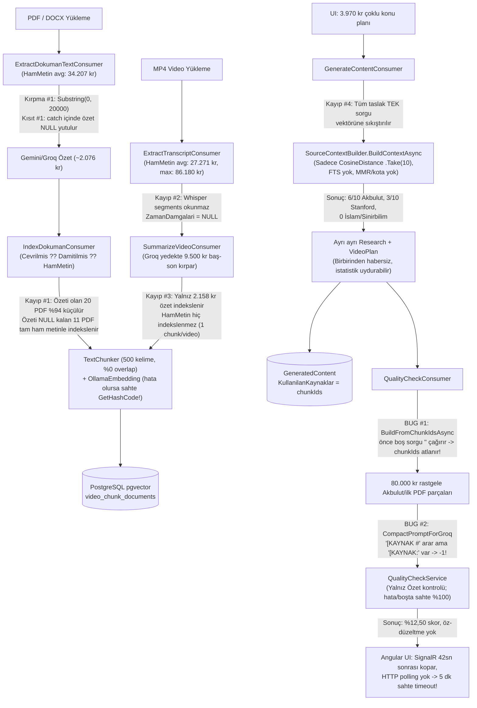

# DOK2: Mevcut Kod Debug ve Akış Raporu (Şu Anki Sistem Nasıl Çalışıyor?)

> **4'lü Mimari Dokümantasyon Seti — Navigasyon:**
> - **DOK1:** [DOK1_HEDEF_VE_GEREKSINIMLER.md](file:///d:/Hoca/VideoOzet/docs/ham-metin-rag-ve-kalite-mimarisi/DOK1_HEDEF_VE_GEREKSINIMLER.md) — *Hedef, Kapsam, İş Paketleri ve Kabul Kriterleri*
> - **DOK2 (Bu Dosya):** [DOK2_MEVCUT_KOD_DEBUG_VE_AKIS_RAPORU.md](file:///d:/Hoca/VideoOzet/docs/ham-metin-rag-ve-kalite-mimarisi/DOK2_MEVCUT_KOD_DEBUG_VE_AKIS_RAPORU.md) — *Mevcut Kod Debug ve Akış Raporu (Şu Anki Sistem Nasıl Çalışıyor?)*
> - **DOK3:** [DOK3_ENDUSTRI_VE_BENZER_PROJELER_ARASTIRMASI.md](file:///d:/Hoca/VideoOzet/docs/ham-metin-rag-ve-kalite-mimarisi/DOK3_ENDUSTRI_VE_BENZER_PROJELER_ARASTIRMASI.md) — *Endüstri, Benzer Projeler ve Literatür Araştırması*
> - **DOK4:** [DOK4_ADIM_ADIM_GELISTIRME_PLANI.md](file:///d:/Hoca/VideoOzet/docs/ham-metin-rag-ve-kalite-mimarisi/DOK4_ADIM_ADIM_GELISTIRME_PLANI.md) — *Adım Adım Geliştirme Planı (Nasıl Geliştireceğiz?)*

---

## 1. Mevcut Uçtan Uca Mimari ve Veri Kaybı / Hata Noktaları

Aşağıdaki diyagram mevcut sistemde dosya yüklemeden kalite kontrole ve UI ekranına kadar verinin hangi noktalarda kırpıldığını, yanlış seçildiğini veya koptuğunu göstermektedir:



---

## 2. Canlı Veritabanı Kanıt Ölçümü (`bd08000a-452a-42cc-bf48-6a8a34a08ae0`)

`"Özgür irade ve algoritmalar"` eğitimi (`46` kaynak: `31` PDF + `15` MP4, toplam `1.501.856` karakter ham metin) ve bu eğitim üzerinde çalıştırılan `7a62a13d-e2e5-4c03-a1eb-7d4c17339f4a` içerik talebi üzerinde gözlemlenen gerçek PostgreSQL verileri:

| Metrik | PDF Dokümanlar (`31` Adet) | Videolar (`15` Adet) |
| :--- | :--- | :--- |
| Ortalama `HamMetin` uzunluğu | **34.207 kr** (Maks: **151.044 kr**) | **27.271 kr** (Maks: **86.180 kr**) |
| Ortalama Özet uzunluğu (`DamitilmisOzetMetni` / `OzetMetni`) | **2.076 kr** (**%93,9 kayıp**) | **2.158 kr** (**%92,1 kayıp**) |
| Özeti üretilebilen kaynak sayısı | `20 / 31` (`11` PDF'te `NULL`) | `15 / 15` |
| `video_chunk_documents` toplam satır sayısı | `218` chunk | **`15` chunk** (video başına yalnız **1 chunk**, `StartTimeMs=0, EndTimeMs=0`) |

**İçerik Talebi `7a62a13d-e2e5-4c03-a1eb-7d4c17339f4a` Gerçek Yürütme İzi:**
- **Zamanlama:** Arka planda `09:41:16` UTC'de başlayıp `09:42:01` UTC'de (**44,98 saniyede**) `Tamamlandi` durumuna geçmiştir (`15.889` kr `VideoPlani` + `8.016` kr `ArastirmaOzeti`). Buna karşın UI ekranında 5 dakika sonunda *"İşlem beklediğimizden çok uzun sürdü"* hatası görünmüştür.
- **RAG Parça Dağılımı:** Seçilen `10` parçanın `6`'sı `Prof_Dr_Berrin_Akbulut_2023_Yapay_Zeka_Ceza_Hukuku_Sorumluluk.pdf` (özeti `NULL` kaldığı için tüm ham metni 18+ chunk olarak indekslenen dosya!), `3`'ü `Stanford Encyclopedia` (`Ozgur_Irade_Problemi` / `Dennett`), `1`'i `10_Ankara_Us_Atolyesi_Yapay_Zeka_Ozgur_Irade.mp4` özetidir. Gazzâlî, Mâtürîdî, İbn Sînâ, Sapolsky, Karen Yeung, Tristan Harris ve Floridi kaynaklarından **0 parça** seçilmiştir.
- **Kalite Kontrol Sonucu:** `GuvenSkorYuzde = 12,50` (`1` Desteklendi, `3` Belirsiz, `4` Desteklenmedi).

---

## 3. Adım Adım Kod Analizi ve 8 Kritik Kök Neden

### Kök Neden 1 — Özetleme Aşamasında Çift Katmanlı Kırpma ve Yutulan Hatalar
1. **Doküman Kırpması ve Yutulan Hata ([ExtractDokumanTextConsumer.cs](file:///d:/Hoca/VideoOzet/src/VideoOzet.Worker/Consumers/ExtractDokumanTextConsumer.cs#L146-L170)):**
   - `#L146`: `var sampleText = extractedText.Length > 20000 ? extractedText.Substring(0, 20000) : extractedText;` satırı `151.044` karakterlik bir kitabın/makalenin **%87'sini LLM özetine göndermeden silmektedir**.
   - `#L167-L170`: Özetleme veya çeviri sırasında API rate-limit / zaman aşımı oluşursa istisna `catch` bloğunda yalnızca `LogWarning` ile yutulmakta ve `damitilmisOzet = null` olarak DB'ye yazılmaktadır.
2. **Whisper Zaman Damgalarının Atılması ([local_whisper_service.py](file:///d:/Hoca/VideoOzet/scripts/local_whisper_service.py#L151-L190), [LocalFasterWhisperSttProvider.cs](file:///d:/Hoca/VideoOzet/src/VideoOzet.Business/Infrastructure/AI/LocalFasterWhisperSttProvider.cs#L128-L140), [ExtractTranscriptConsumer.cs](file:///d:/Hoca/VideoOzet/src/VideoOzet.Worker/Consumers/ExtractTranscriptConsumer.cs#L231-L258)):**
   - Python Whisper servisi `resp_data` içinde `"segments": seg_list` (`start`, `end`, `text`) alanını halihazırda üretip göndermektedir (`local_whisper_service.py#L152-L189`).
   - Ancak `LocalFasterWhisperSttProvider.cs#L130-L140` yalnız `"text"`, `"duration"`, `"elapsed_seconds"`, `"language"` alanlarını okumakta; `"segments"` dizisini atlamaktadır. Sonuçta `ExtractTranscriptConsumer.cs#L235-L258` `VideoTranscript.ZamanDamgalari` kolonunu hiç doldurmamaktadır (`NULL`).
3. **Video Özetlemede Groq Baş-Son Kırpması ([SummarizeVideoConsumer.cs](file:///d:/Hoca/VideoOzet/src/VideoOzet.Worker/Consumers/SummarizeVideoConsumer.cs#L95-L97), [GeminiSummarizer.cs](file:///d:/Hoca/VideoOzet/src/VideoOzet.Business/Infrastructure/AI/GeminiSummarizer.cs#L317-L385)):**
   - Gemini kotası dolup Groq yedeğine geçildiğinde `CallGroqModelsAsync` (`#L317`) `int[] maxCharsPasses = { 9500, 7200 };` kullanır. `CompactPromptForGroq` (`#L374-L385`) metnin ilk %60'ını ve son %40'ını alıp aradaki **~76.000 karakterlik ders anlatımını tamamen kesmektedir**.

---

### Kök Neden 2 — Ham Metin Yerine 2.000 Karakterlik Özetlerin İndekslenmesi ve Bağlamsız Parçalama
1. **Doküman İndeksleme Tersliği ([IndexDokumanConsumer.cs](file:///d:/Hoca/VideoOzet/src/VideoOzet.Worker/Consumers/IndexDokumanConsumer.cs#L90-L101)):**
   - `#L90-L94`:
     ```csharp
     var text = !string.IsNullOrWhiteSpace(dokumanMetin.CevrilmisOzetMetni)
         ? dokumanMetin.CevrilmisOzetMetni
         : (!string.IsNullOrWhiteSpace(dokumanMetin.DamitilmisOzetMetni)
             ? dokumanMetin.DamitilmisOzetMetni
             : dokumanMetin.HamMetin);
     ```
   - Özeti başarıyla üretilen `20` PDF'in `34K–151K` karakterlik `HamMetin` içeriği tamamen çöpe atılıp yalnız ~`2.000` karakterlik özeti tek chunk'a yakın indekslenmiştir. Tersine özetlemesi hata verip `NULL` kalan `11` PDF (`Akbulut`, `Stanford`, `Dennett` vb.) `HamMetin` yedeğine düştüğü için çok sayıda chunk üretip vektör arama uzayını tekeline almıştır.
2. **Video Transkriptlerinin Hiç İndekslenmemesi ([IndexSummaryConsumer.cs](file:///d:/Hoca/VideoOzet/src/VideoOzet.Worker/Consumers/IndexSummaryConsumer.cs#L79-L107)):**
   - `#L79-L82` yalnız `summary.CevrilmisOzetMetni ?? summary.OzetMetni` metnini parçalayıp indeksler; `VideoTranscript.HamMetin`'i hiç okumaz ve tüm videolara `StartTimeMs = 0, EndTimeMs = 0` atar (`#L102-L103`). Bu nedenle 106 dakikalık dersin bile DB'de yalnız **1 adet** özet chunk'ı vardır.
3. **Cümle Sınırsız ve Örtüşmesiz Parçalayıcı ([TextChunker.cs](file:///d:/Hoca/VideoOzet/src/VideoOzet.Business/Infrastructure/AI/TextChunker.cs#L12-L43)):**
   - `#L18-L35` metni boşluklardan bölüp `maxTokens` (gerçekte kelime sayısı) dolduğunda cümle ortasından keser; `overlap = 0` olduğu için kesim sınırındaki argüman iki parçaya bölünüp bağlamını kaybeder ve chunk başında hangi kaynağa/bölüme ait olduğuna dair başlık yoktur.
4. **Sessiz Sahte Embedding Tehlikesi ([OllamaEmbeddingProvider.cs](file:///d:/Hoca/VideoOzet/src/VideoOzet.Business/Infrastructure/AI/OllamaEmbeddingProvider.cs#L28-L31,L85-L113)):**
   - `#L28`: Varsayılan `HttpClient.Timeout = 5 sn` (DI tarafındaki kayıt dışında doğrudan örneklemelerde oldukça kısa) ve `#L85-L89` Ollama hata verirse exception fırlatmak yerine `CreateLocalFallbackEmbedding` (`#L92-L113`) çağırır. Bu metot kelimelerin `string.GetHashCode()` değerini `1024`'e mod alarak sözde-rastgele vektör üretir; anlamsal uzayda hiçbir anlamı olmayan bu vektörler sessizce `pgvector` tablosuna yazılabilir.

---

### Kök Neden 3 — Tek-Sorgulu, Yalnız Vektör Tabanlı ve Çeşitlilik Kotasız RAG (`SourceContextBuilder`)
- **Tek Vektöre Sıkıştırma ([GenerateContentConsumer.cs](file:///d:/Hoca/VideoOzet/src/VideoOzet.Worker/Consumers/GenerateContentConsumer.cs#L76-L80)):**
  - Kullanıcının `3.970` karakterlik 9 maddeli planı (`message.Konu`) doğrudan `new[] { message.Konu }` olarak tek bir embedding vektörüne çevrilmektedir. 9 ayrı tema (İslam düşüncesi, Spinoza, Nörobilim, TikTok/Facebook, Hiper-dürtme, Ceza Hukuku) tek bir ortalama vektörde eridiği için vektör en çok kavram kelime yoğunluğuna sahip birkaç PDF'e kilitlenir.
- **Kota ve Hibrit Eşleşme Eksikliği ([SourceContextBuilder.cs](file:///d:/Hoca/VideoOzet/src/VideoOzet.Business/Services/SourceContextBuilder.cs#L171-L226)):**
  - `#L184-L188`: `OrderBy(c => c.Embedding!.CosineDistance(vec)).Take(10)` — tam metin/anahtar kelime (`tsvector`/`pg_trgm`) skoru yoktur. Özel isimler (*Gazzâlî, Mâtürîdî, Sapolsky*) veya dar teknik terimler vektörde ezilir.
  - Kaynak başına maksimum parça sınırı (`Per-Source Cap`) ve MMR çeşitlilik cezası olmadığı için `Akbulut` tek başına `6/10` yuvayı doldurmuştur.

---

### Kök Neden 4 — `BuildFromChunkIdsAsync` Mantık Hatası (QC'ye Alakasız Bağlam Gitmesi)
- **Hatalı Öncelik Sırası ([SourceContextBuilder.cs](file:///d:/Hoca/VideoOzet/src/VideoOzet.Business/Services/SourceContextBuilder.cs#L292-L335)):**
  - `#L304`: Metot kendisine verilen `chunkIds` parametresini kontrol etmeden **önce** `var fullContext = await BuildContextAsync(egitimId, new[] { "" }, 80000, ct);` çağrısı yapar!
  - `new[] { "" }` boş string olduğu için `BuildContextAsync` `#L161-L171`'de vektör aramasını atlar (`cleanQueries.Any() == false`), `#L218-L225`'teki fallback bloğuna düşer (`Where(c => c.EgitimId == egitimId && c.DokumanId != null)` — hiçbir `ORDER BY` yok!), veritabanından gelen ilk `80.000` karakterlik doküman parçalarını doldurup `#L305-L307`'den hemen `return fullContext;` yapar.
  - Dolayısıyla `#L310-L332`'deki gerçek `chunkIds` sorgusuna büyük eğitimlerde **hiç ulaşılamaz**!
  - Bu hatadan doğrudan etkilenen tüm noktalar:
    - [QualityCheckConsumer.cs#L89](file:///d:/Hoca/VideoOzet/src/VideoOzet.Worker/Consumers/QualityCheckConsumer.cs#L89)
    - [ContentRequestsController.cs#L446](file:///d:/Hoca/VideoOzet/src/VideoOzet.API/Controllers/ContentRequestsController.cs#L446)
    - [SeriesVideoRevisionConsumer.cs#L91](file:///d:/Hoca/VideoOzet/src/VideoOzet.Worker/Consumers/SeriesVideoRevisionConsumer.cs#L91)

---

### Kök Neden 5 — `CompactPromptForGroq` Etiket Uyumsuzluğu (`[KAYNAK #` vs `[KAYNAK:`)
- **Format Uyuşmazlığı ([ClaudeSynthesisProvider.cs](file:///d:/Hoca/VideoOzet/src/VideoOzet.Business/Infrastructure/AI/ClaudeSynthesisProvider.cs#L622-L674)):**
  - `#L622`: `CompactPromptForGroq`, büyük kaynak bloklarını orantılı sıkıştırmak için `prompt.IndexOf("[KAYNAK #", StringComparison.Ordinal)` arar.
  - Oysa [SourceContextBuilder.cs#L261](file:///d:/Hoca/VideoOzet/src/VideoOzet.Business/Services/SourceContextBuilder.cs#L261) büyük eğitimlerde kaynak etiketini `$"[KAYNAK: {label}]"` şeklinde (`#` olmadan!) üretmektedir.
  - `#L622` `-1` döndüğü için `#L668-L673`'teki kör fallback çalışır: Promptun yalnız ilk `%55` başını ve son `%45` kuyruğunu (`9.500` kr limitinde ~`4.200` kr) bırakır. Bu kesim `ARAŞTIRMA ÖZETİ`'nin ikinci yarısını ve `KAYNAKLAR` bölümünün ilk ~`75.000` karakterini ortadan kaldırıp QC modelinin önüne **yalnızca en sondaki tek bir PDF parçasını** (`Akbulut`) bırakır.
  - Yaşanan `%12,50` QC skorunun ana sebebi **Kök Neden 4 + Kök Neden 5** ikilisidir!

---

### Kök Neden 6 — Kopuk Sentez (`Araştırma Özeti` ↛ `Video Planı`) ve Halüsinasyon Açıkları
- **Bağımsız İki Çağrı ([GenerateContentConsumer.cs](file:///d:/Hoca/VideoOzet/src/VideoOzet.Worker/Consumers/GenerateContentConsumer.cs#L112-L123)):**
  - `GenerateResearchSummaryAsync` (`#L112`) ve `GenerateVideoPlanAsync` (`#L119`) ayrı çalışır; `VideoPlani` üretilirken `ArastirmaOzeti` girdi olarak verilmez.
- **Prompt Açıkları ([PromptTemplates.cs](file:///d:/Hoca/VideoOzet/src/VideoOzet.Business/Helpers/PromptTemplates.cs#L5-L157)):**
  - Sentez şablonları örnek olarak `— KAYNAK #1` kullansa da bağlamdaki numaralı parçalarla tutarlı `[K1]` mekanizması bulunmamaktadır.
  - İstatistik/yüzde uydurmama (*"kaynakta olmayan oranları genel bilgiyle tamamlama yasağı"*) ve eksik alt başlıkları ayrı bir uyarı başlığında beyan etme zorunluluğu klasik sentez promptlarında açıkça yer almamaktadır; bu yüzden model *Facebook %70 / TikTok %80* gibi dış istatistikler üretebilmiştir.

---

### Kök Neden 7 — Yalnız Özeti Denetleyen, Sahte `%100` Veren ve Öz-Düzeltmesiz QC
1. **Prompter Metni Denetim Dışı ([QualityCheckConsumer.cs](file:///d:/Hoca/VideoOzet/src/VideoOzet.Worker/Consumers/QualityCheckConsumer.cs#L110-L115)):**
   - `#L111`alnızca `request.GeneratedContent.ArastirmaOzeti`'ni QC'ye verir; kamerada birebir okunacak `VideoPlani` denetlenmez.
2. **Sahte `%100` Güven Skoru Fallbackleri:**
   - [QualityCheckService.cs#L42-L61](file:///d:/Hoca/VideoOzet/src/VideoOzet.Business/Services/QualityCheckService.cs#L42-L61): `contextData` boşsa `GuvenSkorYuzde = 100` (`"desteklendi"`) döner!
   - [QualityCheckService.cs#L132-L151](file:///d:/Hoca/VideoOzet/src/VideoOzet.Business/Services/QualityCheckService.cs#L132-L151): LLM boş veya bozuk JSON döndürürse yine `GuvenSkorYuzde = 100` döner!
   - [QualityCheckService.cs#L166-L185](file:///d:/Hoca/VideoOzet/src/VideoOzet.Business/Services/QualityCheckService.cs#L166-L185): Exception fırlarsa yine `GuvenSkorYuzde = 100` döner!
   - Aynı sahte `%100` mantığı [QualityCheckConsumer.cs#L190-L199](file:///d:/Hoca/VideoOzet/src/VideoOzet.Worker/Consumers/QualityCheckConsumer.cs#L190-L199), [ContentRequestsController.cs#L539-L551](file:///d:/Hoca/VideoOzet/src/VideoOzet.API/Controllers/ContentRequestsController.cs#L539-L551) ve [SeriesVideoRevisionConsumer.cs#L213-L231](file:///d:/Hoca/VideoOzet/src/VideoOzet.Worker/Consumers/SeriesVideoRevisionConsumer.cs#L213-L231) içinde de tekrarlanmıştır.
3. **Öz-Düzeltme Yok:** QC `4/8` iddiayı `"desteklenmedi"` işaretlese bile bu durum doğrudan `Tamamlandi` olarak kullanıcıya gösterilmektedir.

---

### Kök Neden 8 — Tek Seferlik SignalR ve HTTP Polling Yedeği Olmayan UI Bekleme Mantığı
- **SignalR İstemcisi ([signalr.service.ts](file:///d:/Hoca/VideoOzet/src/VideoOzet.UI/src/app/core/services/signalr.service.ts#L21-L38)):**
  - `#L29`: `.withAutomaticReconnect()` parametre almadığı için yalnız `[0, 2000, 10000, 30000]` ms (toplam `42` sn) dener; sonrasında bağlantıyı kalıcı olarak `Disconnected` bırakır.
  - `#L37`: Başlangıç `.start()` hata verirse (API yeniden başlarken) yeniden deneme planlamaz. ([PipelineHub.cs](file:///d:/Hoca/VideoOzet/src/VideoOzet.API/Hubs/PipelineHub.cs#L8-L15) doğrudan `Clients.All` üzerine yayın yaptığı için grup sorunu yoktur, ancak kopan soket yeniden kurulmadığından `ContentReady` olayı kaçırılmaktadır.)
- **Polling Eksikliği ([course-detail.component.ts](file:///d:/Hoca/VideoOzet/src/VideoOzet.UI/src/app/features/course-detail/course-detail.component.ts#L414-L447)):**
  - Dosya işleme listesinde `4` sn'lik polling (`#L121-L125`) olmasına karşın, içerik üretimi (`requestContent()`, `#L414-L447`) API'nin döndürdüğü `contentRequestId`'yi hiç dinlemez ve yalnız SignalR bekler. SignalR mesajı kaçtığında `5 * 60 * 1000` ms sonra sahte zaman aşımı hatası basar.

---

## 4. Seri Modundaki (`SeriesPlan` / `SeriesVideoGeneration`) Durum Notu
Seri modunda [SourceTopicMapper.cs](file:///d:/Hoca/VideoOzet/src/VideoOzet.Business/Services/SourceTopicMapper.cs) kaynakları `KaynakKonuCikarimlari` tablosunda önbellekleyip [SeriesPlanConsumer.cs#L118-L133](file:///d:/Hoca/VideoOzet/src/VideoOzet.Worker/Consumers/SeriesPlanConsumer.cs#L118-L133) içinde `BuildTopicDigestAsync` + `BuildContextAsync(..., maxChars: 60000)` kullanmaktadır. Bölüm üretimindeki [SeriesVideoGenerationConsumer.cs](file:///d:/Hoca/VideoOzet/src/VideoOzet.Worker/Consumers/SeriesVideoGenerationConsumer.cs) ve [SeriesVideoRevisionConsumer.cs](file:///d:/Hoca/VideoOzet/src/VideoOzet.Worker/Consumers/SeriesVideoRevisionConsumer.cs) da yukarıdaki **Kök Neden 2, 3, 4, 5 ve 7**'yi birebir paylaşmaktadır (ham metin indekslenmediği ve `BuildFromChunkIdsAsync` / `QualityCheckService` paylaşıldığı için). Dolayısıyla `DOK4`'teki iyileştirmeler **hem Klasik Modu hem Seri Modunu aynı anda** iyileştirecektir.
