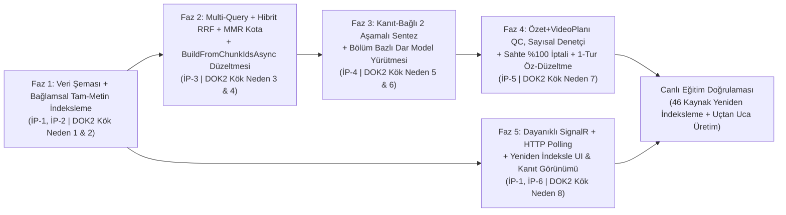

# DOK4: Adım Adım Geliştirme Planı (Nasıl Geliştireceğiz?)

> **4'lü Mimari Dokümantasyon Seti — Navigasyon:**
> - **DOK1:** [DOK1_HEDEF_VE_GEREKSINIMLER.md](file:///d:/Hoca/VideoOzet/docs/ham-metin-rag-ve-kalite-mimarisi/DOK1_HEDEF_VE_GEREKSINIMLER.md) — *Hedef, Kapsam, İş Paketleri ve Kabul Kriterleri*
> - **DOK2:** [DOK2_MEVCUT_KOD_DEBUG_VE_AKIS_RAPORU.md](file:///d:/Hoca/VideoOzet/docs/ham-metin-rag-ve-kalite-mimarisi/DOK2_MEVCUT_KOD_DEBUG_VE_AKIS_RAPORU.md) — *Mevcut Kod Debug ve Akış Raporu (Şu Anki Sistem Nasıl Çalışıyor?)*
> - **DOK3:** [DOK3_ENDUSTRI_VE_BENZER_PROJELER_ARASTIRMASI.md](file:///d:/Hoca/VideoOzet/docs/ham-metin-rag-ve-kalite-mimarisi/DOK3_ENDUSTRI_VE_BENZER_PROJELER_ARASTIRMASI.md) — *Endüstri, Benzer Projeler ve Literatür Araştırması*
> - **DOK4 (Bu Dosya):** [DOK4_ADIM_ADIM_GELISTIRME_PLANI.md](file:///d:/Hoca/VideoOzet/docs/ham-metin-rag-ve-kalite-mimarisi/DOK4_ADIM_ADIM_GELISTIRME_PLANI.md) — *Adım Adım Geliştirme Planı (Nasıl Geliştireceğiz?)*

---

## 1. Faz Sırası ve Bağımlılık Diyagramı

Bu geliştirme planı [DOK1](file:///d:/Hoca/VideoOzet/docs/ham-metin-rag-ve-kalite-mimarisi/DOK1_HEDEF_VE_GEREKSINIMLER.md)'deki tüm kabul kriterlerini (`KK-1`–`KK-5`), [DOK2](file:///d:/Hoca/VideoOzet/docs/ham-metin-rag-ve-kalite-mimarisi/DOK2_MEVCUT_KOD_DEBUG_VE_AKIS_RAPORU.md)'de kanıtlanan 8 kök nedeni ve [DOK3](file:///d:/Hoca/VideoOzet/docs/ham-metin-rag-ve-kalite-mimarisi/DOK3_ENDUSTRI_VE_BENZER_PROJELER_ARASTIRMASI.md)'teki endüstri standartlarını **5 ardışık faza** böler:



---

## 2. Veritabanı Şema ve İndeks Değişiklikleri (`VideoOzet.Data`)

### 2.1. `VideoChunkDocument` Genişletmesi ([VideoChunkDocument.cs](file:///d:/Hoca/VideoOzet/src/VideoOzet.Data/Entities/VideoChunkDocument.cs), [VideoChunkDocumentConfiguration.cs](file:///d:/Hoca/VideoOzet/src/VideoOzet.Data/Configurations/VideoChunkDocumentConfiguration.cs))

Mevcut tablo yalnız `id`, `video_id`, `dokuman_id`, `egitim_id`, `start_time_ms`, `end_time_ms`, `text`, `embedding`, `created_at` kolonlarını içermektedir. Hibrit arama (`tsvector` + `pg_trgm`), bağlamsal metadata, kaynakça filtreleme ve kaynak çeşitliliği için aşağıdaki kolonlar ve indeksler eklenecektir:

```csharp
public enum ChunkTipi
{
    HamMetin = 0,       // DokumanMetin.HamMetin parcalari
    Transkript = 1,     // VideoTranscript.HamMetin zaman damgali parcalari
    OzetKart = 2,       // Hafif kimlik/yonlendirme ozeti (opsiyonel yardimci)
    Kaynakca = 3        // Akademik PDF sonundaki Bibliography/References bolumleri
}

// VideoChunkDocument yeni alanlari:
public int ChunkIndex { get; set; }
public ChunkTipi ChunkTipi { get; set; } = ChunkTipi.HamMetin;
public string KaynakBaslik { get; set; } = string.Empty;
public string? BolumBasligi { get; set; }
public string KaynakDil { get; set; } = "tr";
public KaynakKullanimTuru KullanimTuru { get; set; } = KaynakKullanimTuru.DogrudanReferans;
```

**PostgreSQL İndeks ve Uzantı Yapılandırması (`AppDbContext` + Migration):**
1. **`pg_trgm` uzantısı:** `modelBuilder.HasPostgresExtension("pg_trgm");` (PostgreSQL provider aktifken, [AppDbContext.cs#L42-L45](file:///d:/Hoca/VideoOzet/src/VideoOzet.Data/Context/AppDbContext.cs#L42-L45) içinde `vector` ile birlikte).
2. **Sözcüksel Arama (`GIN` + `pg_trgm`) İndeksleri:**
   - Özel isim ve terim köklerini bozmamak için `'simple'` sözlüğüyle `to_tsvector('simple', text)` GIN indeksi (migration içinde `CREATE INDEX ix_video_chunk_documents_fts ON video_chunk_documents USING gin (to_tsvector('simple', text));`).
   - Türkçe ek almış özel isimler (*Gazzâlî'nin -> Gazzâlî*, *Akbulut'un -> Akbulut*) için `CREATE INDEX ix_video_chunk_documents_trgm ON video_chunk_documents USING gin (text gin_trgm_ops);`.
   - Filtreli indeks: `HasIndex(x => new { x.EgitimId, x.ChunkTipi })`.
3. **Birim Test Uyumluluğu:** [AppDbContext.cs#L61-L107](file:///d:/Hoca/VideoOzet/src/VideoOzet.Data/Context/AppDbContext.cs#L61-L107) içindeki `ConfigureSqliteCompatibility` ve InMemory yollarının yeni kolonlarla sorunsuz çalışması korunacaktır.

### 2.2. Kanıt İzlenebilirliği İçin DTO / Entity Notu
`GeneratedContent.KullanilanKaynaklar`, `ContentVersion` ve `BolumRevizyonu.KullanilanKaynaklar` halihazırda `List<Guid>` (`chunkIds`) tutmaktadır. Bunları bozmadan geriye dönük uyumlu biçimde:
- `VideoChunkDocument` üzerindeki zengin alanlar (`KaynakBaslik`, `BolumBasligi`, `StartTimeMs`, `EndTimeMs`, `ChunkTipi`, `KullanimTuru`) sayesinde API detay uç noktası ([ContentRequestsController.cs](file:///d:/Hoca/VideoOzet/src/VideoOzet.API/Controllers/ContentRequestsController.cs)) seçilen `UsedChunkIds` üzerinden kanıt metadata listesi (`KullanilanKaynakDetaylari`) döndürebilecektir.
- `QcResult` ve `BolumRevizyonu` içinde auto-refine çalışıp çalışmadığını izlemek amacıyla versiyon geçmişine `RevizeTalimati = "Otomatik Kanıt Öz-Düzeltmesi (Auto-Refine)"` kaydı yazılacaktır (`V1` orijinal, `V2` temizlenmiş çıktı).

---

## 3. Faz Bazlı Uygulama Planı (Dosya ve Metot İmzaları)

### Faz 1 — Bağlamsal Tam-Metin Parçalama, Zaman Damgalı STT ve Yeniden İndeksleme (`İP-1`, `İP-2`)

**Referans:** [DOK1 §2 İP-1/İP-2](file:///d:/Hoca/VideoOzet/docs/ham-metin-rag-ve-kalite-mimarisi/DOK1_HEDEF_VE_GEREKSINIMLER.md), [DOK2 Kök Neden 1 & 2](file:///d:/Hoca/VideoOzet/docs/ham-metin-rag-ve-kalite-mimarisi/DOK2_MEVCUT_KOD_DEBUG_VE_AKIS_RAPORU.md), [DOK3 §2.1 & §2.3](file:///d:/Hoca/VideoOzet/docs/ham-metin-rag-ve-kalite-mimarisi/DOK3_ENDUSTRI_VE_BENZER_PROJELER_ARASTIRMASI.md).

1. **Whisper Zaman Damgalarını Kaydetme:**
   - [LocalFasterWhisperSttProvider.cs](file:///d:/Hoca/VideoOzet/src/VideoOzet.Business/Infrastructure/AI/LocalFasterWhisperSttProvider.cs) (`LastSegmentsJson` özelliği) ve [CompositeSttProvider.cs](file:///d:/Hoca/VideoOzet/src/VideoOzet.Business/Infrastructure/AI/CompositeSttProvider.cs): Python [local_whisper_service.py#L189](file:///d:/Hoca/VideoOzet/scripts/local_whisper_service.py#L189) tarafından gönderilen `segments` dizisini (`[{start, end, text}]`) yakalayacak.
   - [ExtractTranscriptConsumer.cs#L235-L258](file:///d:/Hoca/VideoOzet/src/VideoOzet.Worker/Consumers/ExtractTranscriptConsumer.cs#L235-L258): `VideoTranscript.ZamanDamgalari` alanını dolduracak (çok parçalı seslerde parça süre ofsetini segmentlere ekleyerek).
2. **Yeni Bağlamsal Parçalayıcı (`IContextualTextChunker` / `ContextualTextChunker`):**
   - Dosya: `src/VideoOzet.Business/Interfaces/IContextualTextChunker.cs` ve `src/VideoOzet.Business/Infrastructure/AI/ContextualTextChunker.cs` ([TextChunker.cs](file:///d:/Hoca/VideoOzet/src/VideoOzet.Business/Infrastructure/AI/TextChunker.cs) korunup `IContextualTextChunker` ayrı/gelişmiş arayüz olarak veya mevcut `ITextChunker`'a ek metotla DI'a bağlanacaktır).
   - **Veri Yapısı ve İmza:**
     ```csharp
     public sealed record ContextualChunkOptions(
         string KaynakBaslik,
         string KaynakTuru, // "DOKÜMAN" | "VİDEO"
         string Dil,
         KaynakKullanimTuru KullanimTuru,
         int TargetWords = 500,
         int OverlapWords = 75,
         int? VideoDurationSeconds = null);

     public sealed record ContextualChunk(
         int ChunkIndex,
         ChunkTipi ChunkTipi,
         string? BolumBasligi,
         int StartTimeMs,
         int EndTimeMs,
         string RawText,
         string ContextualizedText);

     public interface IContextualTextChunker
     {
         IReadOnlyList<ContextualChunk> ChunkDocument(string hamMetin, ContextualChunkOptions options);
         IReadOnlyList<ContextualChunk> ChunkTranscript(string hamMetin, string? zamanDamgalariJson, ContextualChunkOptions options);
     }
     ```
   - **Davranış:**
     - Paragraf (`\n\n`) ve cümle (`. `, `? `, `! `) sınırlarını bozmadan `~500` kelimelik parçalar üretir; sonraki parçaya önceki son `~75` kelime (`%15`) tam cümle sınırından taşınır.
     - Aktif bölüm başlığını (`1.2. ...`, `## ...`, Tam büyük harf başlık satırları) tespit edip `BolumBasligi` olarak saklar.
     - `KAYNAKÇA`, `REFERENCES`, `BIBLIOGRAPHY`, `KAYNAKLAR` başlığı altındaki son blokları `ChunkTipi.Kaynakca` olarak etiketler (false-positive önlemek için yalnız dokümanın son `%30`'unda başlayan liste ağırlıklı referans bloklarında devreye girer).
     - Video transkriptinde `zamanDamgalariJson` doluysa segmentleri birleştirip gerçek `StartTimeMs`–`EndTimeMs` aralıklarını yazar; boşsa (mevcut videolar) `VideoDurationSeconds` (veya kelime/dakika oranı `150 kelime/dk`) üzerinden oransal `StartTimeMs`–`EndTimeMs` hesaplar.
     - `ContextualizedText` başına bağlamsal üstbilgi ekler:
       `[Kaynak: {KaynakBaslik} | Tür: {KaynakTuru} | {Bölüm veya mm:ss-mm:ss} | Dil: {Dil} | Mod: {Mod}]`
3. **Sahte Fallback Embedding Kaldırılması (`OllamaEmbeddingProvider.cs`):**
   - [OllamaEmbeddingProvider.cs#L28,L82-L113](file:///d:/Hoca/VideoOzet/src/VideoOzet.Business/Infrastructure/AI/OllamaEmbeddingProvider.cs#L28):
     - HTTP timeout varsayılanı en az `60 sn`'ye çıkarılır (batch 32 parça için).
     - `StandaloneMode == true` durumu hariç, Ollama erişim hatasında veya boş yanıtında `CreateLocalFallbackEmbedding` çağrılmayacak; `InvalidOperationException` fırlatılarak MassTransit retry zinciri devreye alınacaktır.
     - `GenerateEmbeddingsAsync` içindeki toplu çağrılarda gerekirse alt-batch bölme ve vektör boyutu (`1024`) doğrulaması yapılacaktır.
4. **Tam Metin İndeksleme ve Kırpmasız Özet Rol Ayrımı:**
   - [IndexDokumanConsumer.cs#L90-L159](file:///d:/Hoca/VideoOzet/src/VideoOzet.Worker/Consumers/IndexDokumanConsumer.cs#L90-L159): Özet yerine doğrudan `dokumanMetin.HamMetin` ile `IContextualTextChunker.ChunkDocument(...)` kullanır. Özet varsa ayrıca `1` adet `ChunkTipi.OzetKart` ekleyebilir.
   - [IndexSummaryConsumer.cs#L79-L118](file:///d:/Hoca/VideoOzet/src/VideoOzet.Worker/Consumers/IndexSummaryConsumer.cs#L79-L118): `VideoTranscript` kaydını da yükler; `transcript.HamMetin` + `transcript.ZamanDamgalari` + `video.SureSaniye` ile `IContextualTextChunker.ChunkTranscript(...)` çalıştırır. Ek olarak mevcut `VideoSummary` (Türkçe çevirisi dahil) `ChunkTipi.OzetKart` olarak `1` yardımcı parça biçiminde indekslenir.
   - [ExtractDokumanTextConsumer.cs#L146](file:///d:/Hoca/VideoOzet/src/VideoOzet.Worker/Consumers/ExtractDokumanTextConsumer.cs#L146) ve [GeminiSummarizer.cs#L374-L385](file:///d:/Hoca/VideoOzet/src/VideoOzet.Business/Infrastructure/AI/GeminiSummarizer.cs#L374-L385): `Substring(0, 20000)` ve `9500` baş-son kesme kaldırılır; `> 22.000` karakter metinlerde hafif parça-birleştir (`Map-Reduce`) ile "Kaynak Kimlik Kartı" çıkarılır ve hata yutulsa bile indeksleme bağımsız çalışır.
5. **Mevcut Eğitimleri Tek Tıkla "Ham Metinle Yeniden İndeksle" Akışı:**
   - Yeni event: `ReindexEgitimEvent(Guid EgitimId)` veya mevcut `DokumanTextExtractedEvent` / `TranscriptReadyEvent` benzeri yalnız indekslemeye yönlendiren `IndexDokumanRequestedEvent` / `IndexVideoTranscriptRequestedEvent`.
   - Yeni endpoint ([DosyalarController.cs](file:///d:/Hoca/VideoOzet/src/VideoOzet.API/Controllers/DosyalarController.cs)):
     `POST /api/egitimler/{egitimId:guid}/dosyalar/yeniden-indeksle` -> `HamMetin`'i hazır olan tüm PDF'ler ve `VideoTranscript`'i hazır olan tüm videolar için **hiç dosya indirmeden ve STT yapmadan** yalnız indeksleme olaylarını (`IndexDokumanConsumer` / `IndexSummaryConsumer`) kuyruğa atar (`202 Accepted`, kaç dosya kuyruğa alındı bilgisini döner).

---

### Faz 2 — Çoklu Alt-Sorgu + Hibrit RRF + Çapraz Dil + MMR + `BuildFromChunkIdsAsync` Düzeltmesi (`İP-3`)

**Referans:** [DOK1 §2 İP-3](file:///d:/Hoca/VideoOzet/docs/ham-metin-rag-ve-kalite-mimarisi/DOK1_HEDEF_VE_GEREKSINIMLER.md), [DOK2 Kök Neden 3 & 4](file:///d:/Hoca/VideoOzet/docs/ham-metin-rag-ve-kalite-mimarisi/DOK2_MEVCUT_KOD_DEBUG_VE_AKIS_RAPORU.md), [DOK3 §2.1, §2.3 & §2.4](file:///d:/Hoca/VideoOzet/docs/ham-metin-rag-ve-kalite-mimarisi/DOK3_ENDUSTRI_VE_BENZER_PROJELER_ARASTIRMASI.md).

1. **Alt-Sorgu Ayrıştırıcı ve Çapraz Dil Genişletici (`IQueryDecomposer`):**
   - Dosya: `src/VideoOzet.Business/Interfaces/IQueryDecomposer.cs` ve `src/VideoOzet.Business/Services/QueryDecomposer.cs`.
   - İmza:
     ```csharp
     public sealed record DecomposedQuery(
         int Index,
         string Title,
         string OriginalText,
         string ExpandedKeywordsText, // TR + EN kilit terimler (yabanci kaynak varsa)
         string[] LexicalTerms);

     public interface IQueryDecomposer
     {
         Task<IReadOnlyList<DecomposedQuery>> DecomposeAsync(
             string rawTopicOrOutline,
             IReadOnlyCollection<string> courseLanguages,
             CancellationToken ct = default);
     }
     ```
   - **Mantık:**
     - Numaralı maddeleri (`1.`, `2.`, `- `, satır başlıklarını) deterministik regex ile ayrı alt-sorgulara böler (`maks. 12` alt-sorgu). Tek kısa konu gelirse yine `1–3` odak sorgusuna çevirir.
     - Eğitimde `tr` dışı (`en`, `de` vb.) kaynaklar varsa, alt-sorgudan çıkarılan anahtar kavramların İngilizce karşılıklarını hafif/hızlı terim haritası (+ isteğe bağlı kısa LLM terim çağrısı, zaman aşımı güvenli fallback ile) üreterek `LexicalTerms` içine ekler.
2. **`BuildFromChunkIdsAsync` Hatasının Kesin Düzeltilmesi ([SourceContextBuilder.cs#L292-L335](file:///d:/Hoca/VideoOzet/src/VideoOzet.Business/Services/SourceContextBuilder.cs#L292-L335)):**
   - Metot başındaki `BuildContextAsync(egitimId, new[] { "" }, 80000, ct)` çağrısı **tamamen silinir**!
   - `chunkIds` listesi boş değilse, veritabanından yalnız o `Id`'lere sahip `VideoChunkDocument` satırları sırası korunarak çekilir, kaynak adı / bölüm başlığı / zaman damgası / `[K1]..[Kn]` etiketleriyle biçimlendirilir.
   - Yalnız `chunkIds` tamamen boşsa ve eğitim toplam chunk karakteri `<= 80.000` ise tam bağlama düşer; büyük eğitimlerde asla rastgele ilk 80K karakteri çekmez.
3. **Hibrit RRF + MMR + Kaynak Kotası Motoru ([SourceContextBuilder.cs](file:///d:/Hoca/VideoOzet/src/VideoOzet.Business/Services/SourceContextBuilder.cs)):**
   - Yeni yardımcı tip `SourceContextResult` alanları:
     ```csharp
     public class SourceContextResult
     {
         public string ContextText { get; set; } = string.Empty;
         public List<Guid> UsedChunkIds { get; set; } = new();
         public List<ChunkEvidenceItem> Evidences { get; set; } = new(); // [K1], Baslik, Zaman, Dil, Mod
         public List<SubTopicCoverage> CoverageMatrix { get; set; } = new();
         public bool UsedFullDocumentFallback { get; set; }
     }
     ```
   - Her `DecomposedQuery` için:
     1. **Dense Adayları:** `ChunkTipi != ChunkTipi.Kaynakca` filtresiyle `pgvector` `CosineDistance` ilk `25` aday.
     2. **Lexical Adayları:** PostgreSQL `EF.Functions.ToTsVector("simple", c.Text).Matches(EF.Functions.WebSearchToTsQuery("simple", orTerms))` + özel isim/kök için `pg_trgm` (`EF.Functions.TrigramsWordSimilarity`) / `ILIKE` ilk `25` aday. (SQLite/InMemory test ortamında C# içi BM25/token-overlap yedeği çalışır.)
     3. **RRF Birleştirme ($k = 60$):** Her aday için $\text{RRF}(d) = \frac{1}{60 + r_{\text{dense}}} + \frac{1}{60 + r_{\text{lex}}}$ hesaplanır (`OzetKart` için küçük bir ağırlık çarpanı `0.75` uygulanır ki asıl içerikte ham metin ve transkript parçaları kazansın).
   - **Global MMR Seçimi ve Kaynak Çeşitliliği Kotası:**
     - `TotalTargetChunks` (ör. `20–28`, `maxChars` bütçesine kadar, varsayılan `90.000` kr) kadar parça seçilirken her alt-sorgunun en iyi `1–2` parçası öncelikli garanti edilir (`Round-Robin Sub-Query Guarantee`).
     - `MaxChunksPerSource`: Eğitimde `>= 8` kaynak varsa aynı `DokumanId`/`VideoId` en fazla **`3` parça** alabilir (daha az kaynaklı eğitimlerde `Math.Ceiling(24.0 / sourceCount)` ile dinamik artar).
     - MMR cezası ($\lambda = 0.72$): Zaten seçilmiş aynı kaynaktan veya anlamsal olarak çok benzer (`> 0.88` cosine similarity) parçalara ceza uygulanır.
   - Çıktı formatı tüm consumer/provider'larda standart `[K1]`, `[K2]`, ..., `[Kn]` kanıt kodlarıyla üretilir:
     `=== [K1] | DOKÜMAN: 05_Imam_Gazzali... | Bölüm: 2.1 Kesb Teorisi | Mod: DOĞRUDAN REFERANS ===`

---

### Faz 3 — Kanıt-Bağlı İki Aşamalı Sentez ve Dar Modellerde Bölüm Bazlı Üretim (`İP-4`)

**Referans:** [DOK1 §2 İP-4](file:///d:/Hoca/VideoOzet/docs/ham-metin-rag-ve-kalite-mimarisi/DOK1_HEDEF_VE_GEREKSINIMLER.md), [DOK2 Kök Neden 5 & 6](file:///d:/Hoca/VideoOzet/docs/ham-metin-rag-ve-kalite-mimarisi/DOK2_MEVCUT_KOD_DEBUG_VE_AKIS_RAPORU.md), [DOK3 §2.2 & §2.5](file:///d:/Hoca/VideoOzet/docs/ham-metin-rag-ve-kalite-mimarisi/DOK3_ENDUSTRI_VE_BENZER_PROJELER_ARASTIRMASI.md).

1. **Prompt Güncellemeleri ([PromptTemplates.cs](file:///d:/Hoca/VideoOzet/src/VideoOzet.Business/Helpers/PromptTemplates.cs)):**
   - `SynthesisResearchPrompt`:
     - Her kritik kavramsal veya sayısal iddianın sonuna mutlaka `[K1]`, `[K4]` formatında kanıt kodu yazılması zorunlu kılınır.
     - **Sıfır Uydurma İstatistik Kuralı:** *"Verilen `[K#]` bloklarında açıkça yazmayan hiçbir yüzde (`%`), yıl, deney sayısı veya harici rapor adını kendi bilginle ekleme!"*
     - **Kapsam Dürüstlüğü:** Kullanıcının istediği başlıklardan bağlamda kanıtı zayıf veya hiç olmayanlar uydurulmadan `## Kaynaklarda Doğrudan Karşılığı Bulunmayan / Eksik Alt Başlıklar` altında listelenir.
   - `SynthesisVideoPlanPrompt`:
     - İmzaya `ARAŞTIRMA ÖZETİ` parametresi eklenir (`{3}`).
     - Stüdyo prompter metni, `ArastirmaOzeti`'ndeki doğrulanmış argümanları ve `[K#]` kaynak modlarını (`Doğrudan Referans` vs `Dış Kaynak`) birebir izler; dışarıdan istatistik ekleyemez.
2. **İki Aşamalı Bağlı Zincir ([GenerateContentConsumer.cs](file:///d:/Hoca/VideoOzet/src/VideoOzet.Worker/Consumers/GenerateContentConsumer.cs), [ISynthesisProvider.cs](file:///d:/Hoca/VideoOzet/src/VideoOzet.Business/Interfaces/ISynthesisProvider.cs), [ClaudeSynthesisProvider.cs](file:///d:/Hoca/VideoOzet/src/VideoOzet.Business/Infrastructure/AI/ClaudeSynthesisProvider.cs)):**
   - `GenerateContentConsumer`: Önce `IQueryDecomposer.DecomposeAsync(...)` -> `BuildContextAsync(...)` -> `GenerateResearchSummaryAsync(...)` çalıştırır; ardından üretilen `arastirmaOzeti`'ni yeni parametresiyle `GenerateVideoPlanAsync(topic, targetLength, contextData, arastirmaOzeti, ct)` metoduna geçirir.
3. **`CompactPromptForGroq` Düzeltmesi ve Bölüm Bazlı Dar-TPM Stratejisi ([ClaudeSynthesisProvider.cs#L600-L674](file:///d:/Hoca/VideoOzet/src/VideoOzet.Business/Infrastructure/AI/ClaudeSynthesisProvider.cs#L600-L674)):**
   - `CompactPromptForGroq` içindeki `[KAYNAK #` araması hem `[K` (`=== [K`) hem `[KAYNAK #` hem `[KAYNAK:` ayraçlarını tanıyacak şekilde düzeltilir ve mevcut döküman/özet gövdesi kesilmez.
   - Daha önemlisi, **Groq gibi dar TPM (`<= 8.000` TPM) yedeğine düşüldüğünde** büyük promptu kör kesmek yerine `SectionedSynthesizer` devreye girer:
     - Araştırma özetini alt-konu gruplarına (`2–3` başlık/çağrı) bölerek her çağrıda yalnız ilgili `[K#]` parçalarını gönderir; ardından bölümleri tek tutarlı Markdown belgesinde birleştirir.
     - Video planını da aynı şekilde `2–3` sahnelik gruplar halinde üretir (`Sahne 1–3`, `Sahne 4–6`...) ve önceki grubun kısa özetini aktararak sürekliliği korur.

---

### Faz 4 — Çift Dokümanlı Kanıt-Bağlı QC, Sayısal Denetçi ve 1-Tur Öz-Düzeltme (`İP-5`)

**Referans:** [DOK1 §2 İP-5](file:///d:/Hoca/VideoOzet/docs/ham-metin-rag-ve-kalite-mimarisi/DOK1_HEDEF_VE_GEREKSINIMLER.md), [DOK2 Kök Neden 7](file:///d:/Hoca/VideoOzet/docs/ham-metin-rag-ve-kalite-mimarisi/DOK2_MEVCUT_KOD_DEBUG_VE_AKIS_RAPORU.md), [DOK3 §2.6](file:///d:/Hoca/VideoOzet/docs/ham-metin-rag-ve-kalite-mimarisi/DOK3_ENDUSTRI_VE_BENZER_PROJELER_ARASTIRMASI.md).

1. **Deterministik Sayısal ve Atıf Tarayıcı (`IDeterministicClaimScanner` / `DeterministicClaimScanner`):**
   - Dosya: `src/VideoOzet.Business/Services/DeterministicClaimScanner.cs`.
   - İmza:
     ```csharp
     public sealed record NumericAnomaly(string MatchedValue, string Sentence, bool ExistsInSources);
     public interface IDeterministicClaimScanner
     {
         IReadOnlyList<NumericAnomaly> FindUngroundedNumbersAndCitations(string generatedMarkdown, string contextData);
     }
     ```
   - Üretilen `ArastirmaOzeti` + `VideoPlani` içindeki yüzdeleri (`%70`, `70%`, `yüzde 70`), `1900–2099` yıllarını ve harici rapor atıflarını regex ile bulup `contextData` içinde geçip geçmediğini denetler. Eşleşmeyen sayılar `BatchQcPrompt` içerisine `"ÖNCELİKLİ ŞÜPHELİ SAYISAL İFADELER"` olarak enjekte edilir.
2. **Sahte `%100` Fallback'lerin Tamamen Silinmesi ve Video Planı Denetimi:**
   - [QualityCheckService.cs#L42-L61,L132-L185](file:///d:/Hoca/VideoOzet/src/VideoOzet.Business/Services/QualityCheckService.cs#L42-L61):
     - `contextData` boşsa: `GuvenSkorYuzde = 0`, `Durum = BolumDurumu.Hata`, açıklama = *"Referans kaynak bağlamı bulunamadığı için doğrulama yapılamadı."*
     - JSON parse/LLM hatasında: `GuvenSkorYuzde = 0`, `Durum = BolumDurumu.Hata`, `DesteklenenSayisi = 0`, `BelirsizSayisi = 1` (asla sahte `"desteklendi"` / `100` dönmez!).
   - Aynı temizlik [QualityCheckConsumer.cs#L190-L199](file:///d:/Hoca/VideoOzet/src/VideoOzet.Worker/Consumers/QualityCheckConsumer.cs#L190-L199), [ContentRequestsController.cs#L539-L551](file:///d:/Hoca/VideoOzet/src/VideoOzet.API/Controllers/ContentRequestsController.cs#L539-L551) ve [SeriesVideoRevisionConsumer.cs#L213-L231](file:///d:/Hoca/VideoOzet/src/VideoOzet.Worker/Consumers/SeriesVideoRevisionConsumer.cs#L213-L231) içindeki kopya fallback'lere de uygulanır (bu kopyalar kaldırılıp ortak `IQualityCheckService` tek merkez yapılır!).
   - `BatchQcPrompt` ve `QualityCheckService`: `ArastirmaOzeti` yanında `VideoPlani` içindeki prompter bloklarını da (`[Prompter Metni]` metinlerini) denetler (`claimCount = 12`: `8` özet iddiası + `4` prompter iddiası, her birinde `kanit_kodu` ve `hedef_alan` etiketli).
3. **1-Turlu Otomatik Öz-Düzeltme Döngüsü (`Auto-Refine`):**
   - [QualityCheckConsumer.cs](file:///d:/Hoca/VideoOzet/src/VideoOzet.Worker/Consumers/QualityCheckConsumer.cs) ve [SeriesVideoGenerationConsumer.cs](file:///d:/Hoca/VideoOzet/src/VideoOzet.Worker/Consumers/SeriesVideoGenerationConsumer.cs):
     - İlk QC değerlendirmesinde `DesteklenmeyenSayisi > 0` veya `(BelirsizSayisi > 2 && GuvenSkorYuzde < 75)` çıkarsa:
       1. İlk çıktıyı `ContentVersion` (`VersiyonNo = 1`, `RevizeTalimati = "İlk Üretim (Öz-Düzeltme Öncesi)"`) olarak kaydeder.
       2. Desteksiz/uydurma iddialar listesiyle `_synthesisProvider.ReviseContentAsync(...)` metodunu çağırarak *"Desteklenmeyen iddiaları çıkar veya yalnız `[K#]` kaynaklarında açıkça geçen bulgularla değiştir"* talimatıyla `ArastirmaOzeti` (ve gerekirse `VideoPlani`) revize edilir.
       3. Revize çıktı üzerinde QC son kez yeniden çalıştırılır (`VersiyonNo = 2`, `RevizeTalimati = "Otomatik Kanıt Öz-Düzeltmesi"`), `GeneratedContent` güncellenir ve `Tamamlandi` yayınlanır. (Maksimum 1 tur — sonsuz döngü riski yok.)

---

### Faz 5 — Kopmayan SignalR + HTTP Polling Yedeği + UI İndeks & Kanıt Görünümü (`İP-1`, `İP-6`)

**Referans:** [DOK1 §2 İP-1 & İP-6](file:///d:/Hoca/VideoOzet/docs/ham-metin-rag-ve-kalite-mimarisi/DOK1_HEDEF_VE_GEREKSINIMLER.md), [DOK2 Kök Neden 8](file:///d:/Hoca/VideoOzet/docs/ham-metin-rag-ve-kalite-mimarisi/DOK2_MEVCUT_KOD_DEBUG_VE_AKIS_RAPORU.md).

1. **`SignalRService` İyileştirmesi ([signalr.service.ts](file:///d:/Hoca/VideoOzet/src/VideoOzet.UI/src/app/core/services/signalr.service.ts)):**
   - `.withAutomaticReconnect([0, 2000, 5000, 10000, 15000, 30000, 30000, 30000])` + `onclose` içinde kontrollü yeniden başlatma zamanlayıcısı.
   - `startConnection()` başlangıçta hata alırsa `5` sn sonra tekrar bağlanmayı dener.
2. **3 Saniyelik HTTP Polling Yedeği ([course-detail.component.ts](file:///d:/Hoca/VideoOzet/src/VideoOzet.UI/src/app/features/course-detail/course-detail.component.ts#L414-L470)):**
   - `requestContent()`: `createContentRequest` yanıtındaki `res.contentRequestId` değerini `activeContentRequestId` olarak saklar; `3.000 ms` aralıkla `apiService.getContentRequest(id)` kontrol eder. Backend `durum === 'Tamamlandi'` veya `'Hata'` döndürdüğü anda SignalR beklemeden UI'ı günceller ve zamanlayıcıyı durdurur.
   - `planSeries()`: Benzer şekilde `3.000 ms` seri durum polling yedeği eklenir.
   - Zaman aşımı metni gerçekçi bekleme + "Arka planda devam ediyorsa Geçmiş Taleplerden açabilirsiniz" bilgisiyle iyileştirilir.
3. **"Ham Metinle Yeniden İndeksle" UI Butonu ve Kanıt İzlenebilirliği ([api.service.ts](file:///d:/Hoca/VideoOzet/src/VideoOzet.UI/src/app/core/services/api.service.ts), [course-detail.component.html](file:///d:/Hoca/VideoOzet/src/VideoOzet.UI/src/app/features/course-detail/course-detail.component.html)):**
   - Üst aksiyon çubuğuna `"Ham Metinle Yeniden İndeksle"` butonu eklenir (`POST /api/egitimler/{egitimId}/dosyalar/yeniden-indeksle`).
   - İçerik sonuç panelinde `KullanilanKaynakDetaylari` (`[K1]..[Kn]`, kaynak adı, bölüm başlığı veya `mm:ss–mm:ss` video zaman damgası, kullanım modu) listelenir; QC detay kartında her iddianın doğrulandığı kanıt kodu rozeti gösterilir.

---

## 4. Test, Doğrulama ve Canlı Geçiş Planı

### 4.1. Otomatik Birim ve Entegrasyon Testleri (`tests/VideoOzet.UnitTests/`)
1. `ContextualTextChunkerTests`: Cümle sınırı korunumu, `%15` örtüşme doğruluğu, `KAYNAKÇA/REFERENCES` bloğunun `ChunkTipi.Kaynakca` olarak ayrılması, Whisper JSON segmentlerinden `StartTimeMs`–`EndTimeMs` hesabı ve eski videolar için süre tabanlı oransal zaman tahmini.
2. `OllamaEmbeddingProviderTests`: Hata/timeout durumunda sahte `GetHashCode()` vektörü dönülmediğinin (`InvalidOperationException` fırlatıldığının) ve `StandaloneMode=true` dışında sahte vektör üretilmediğinin testi.
3. `SourceContextBuilderRegressionTests`:
   - Büyük eğitimde (`> 80.000` kr) `BuildFromChunkIdsAsync` çağrısının gerçekten gönderilen `chunkIds`'i getirdiğinin regresyon testi (`DOK2 Kök Neden 4`).
   - Çoklu kaynakta `MaxChunksPerSource` tavanının tek kaynağın tekelleşmesini engellediğinin testi.
4. `DeterministicClaimScannerTests`: Kaynakta olmayan `"%70"` / `"%80"` ifadelerinin yakalanması ve kaynakta geçen sayıların yanlış pozitif vermemesi.
5. `QualityCheckServiceTests`: Boş bağlam ve bozuk JSON durumunda asla `GuvenSkorYuzde = 100` dönmediğinin, `Durum = BolumDurumu.Hata` / skor `0` döndüğünün testi.
6. `SectionedSynthesisAndCompactTests`: `CompactPromptForGroq` fonksiyonunun `[K1]` / `[KAYNAK:` ayraçlarını koruduğunun ve baş-son kör kesmeye düşmediğinin testi.

### 4.2. Mevcut Canlı Eğitim Üzerinde Doğrulama Senaryosu (`bd08000a-452a-42cc-bf48-6a8a34a08ae0`)
1. `dotnet build VideoOzet.slnx` ve `dotnet test` (tüm testler yeşil).
2. EF Core Migration uygulandıktan sonra API & Worker başlatılır; UI'dan **"Ham Metinle Yeniden İndeksle"** tetiklenerek `31` PDF + `15` MP4'ün (`1,5M+` kr ham metin) yeniden indekslenmesi tamamlanır.
3. PostgreSQL sorgusuyla doğrulanır:
   - Tüm PDF ve videoların yalnız 1 özet parçası yerine çoklu `HamMetin` / `Transkript` parçalarına sahip olduğu,
   - Videolarda `end_time_ms > 0` zaman aralıklarının oluştuğu,
   - `KAYNAKÇA` parçalarının `chunk_tipi = 3` (`Kaynakca`) olarak ayrıldığı.
4. Aynı 9 maddelik `"Özgür irade ve algoritmalar"` konu planıyla yeni bir içerik talebi çalıştırılır ve şu sonuçlar doğrulanır:
   - Seçilen `UsedChunkIds` dağılımında artık Gazzâlî/Mâtürîdî/İbn Sînâ, Sapolsky/neurobiology, Karen Yeung/Tristan Harris ve Akbulut/Hukuk kaynaklarının dengeli biçimde (`kaynak başı <= 3 chunk`) yer aldığı,
   - QC skorunun gerçek kanıtlar üzerinden hesaplandığı, uydurma yüzde/istatistik kalmadığı (`0` sahte sayı) ve SignalR/polling üzerinden sonucun `3` sn içinde UI ekranına düştüğü.
